# SolarLens

[](https://github.com/muhammadmobi/SolarLens/actions/workflows/checks.yml)
[](https://github.com/muhammadmobi/SolarLens/releases)
[](LICENSE)

**One screen for all your inverters.** SolarLens polls SolisCloud and SolarMan, stores every
reading in your own database, and shows every system side by side — live power, today /
month / year / lifetime energy, grid import & export, battery state — on a page you can open
from any device. It runs entirely on Cloudflare's free tier (Workers + D1) or locally.

It is for the owner of solar systems on either cloud - one system or many - who wants them on
one page, the readings kept in a database of their own, and nothing to pay for hosting; and
for whoever looks after such a deployment, for whom [docs/handoff.md](docs/handoff.md) is
written.

**[See it running](https://muhammadmobi.github.io/SolarLens/)** — the real dashboard, on made-up
data, with no server behind it. **[Deploy your own](#quick-start-10-minutes)** on Cloudflare's
free tier in about ten minutes.

| | |
|---|---|
| 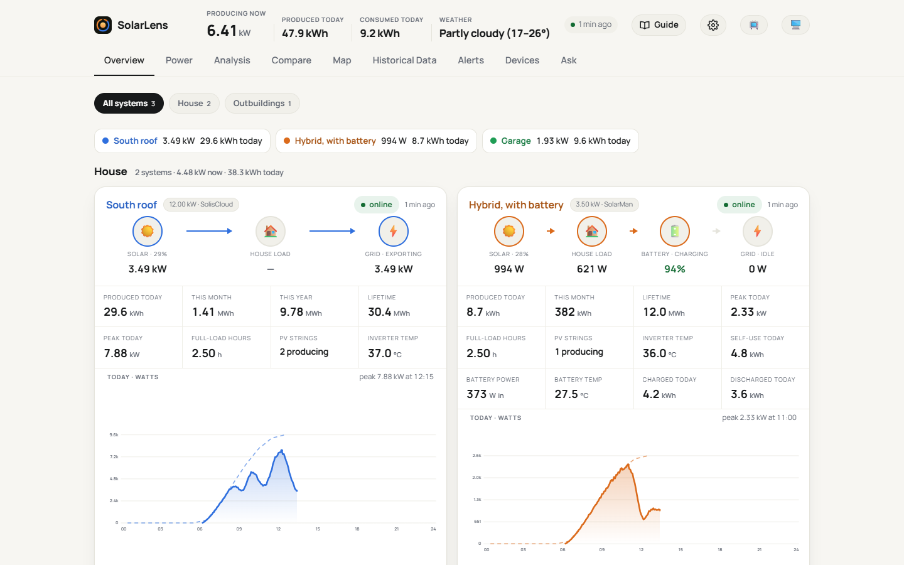 | 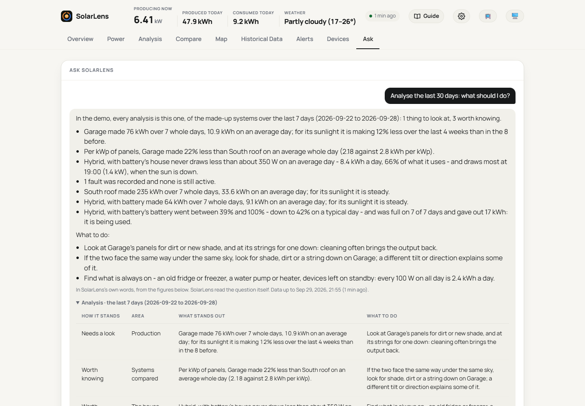 |
| 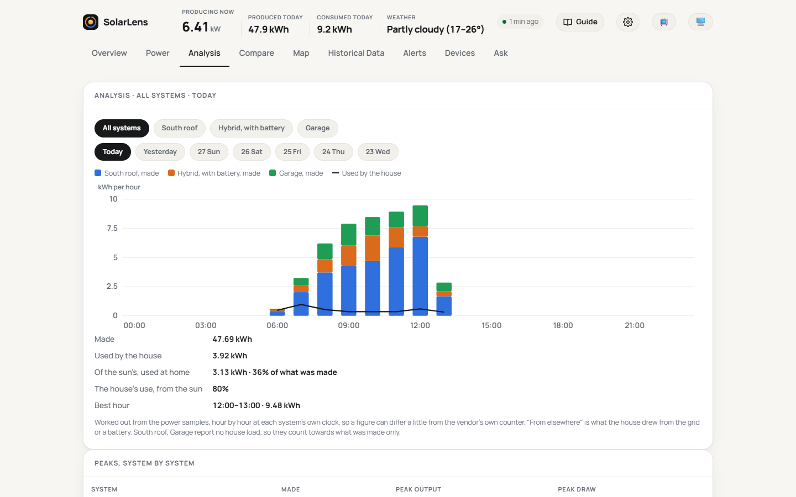 | 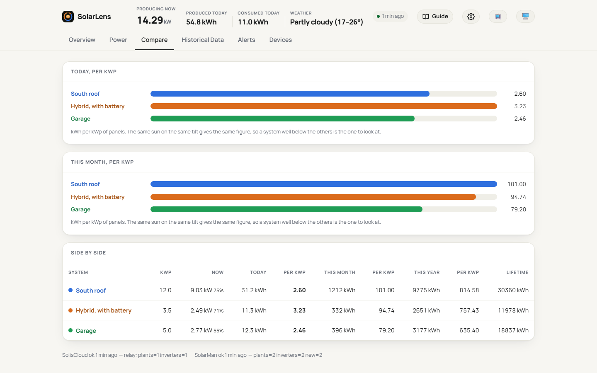 |
| 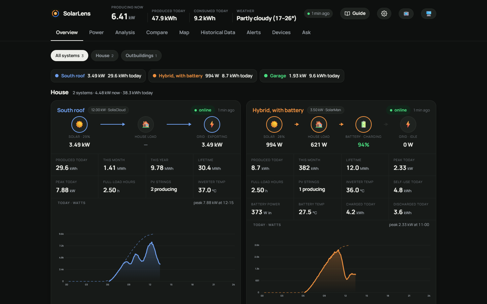 | 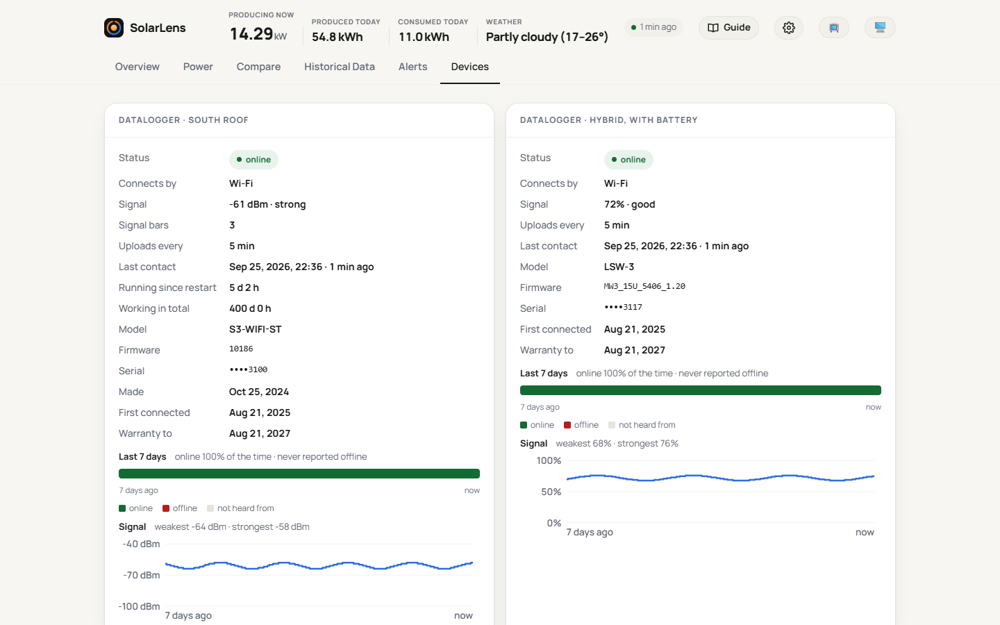 |
| 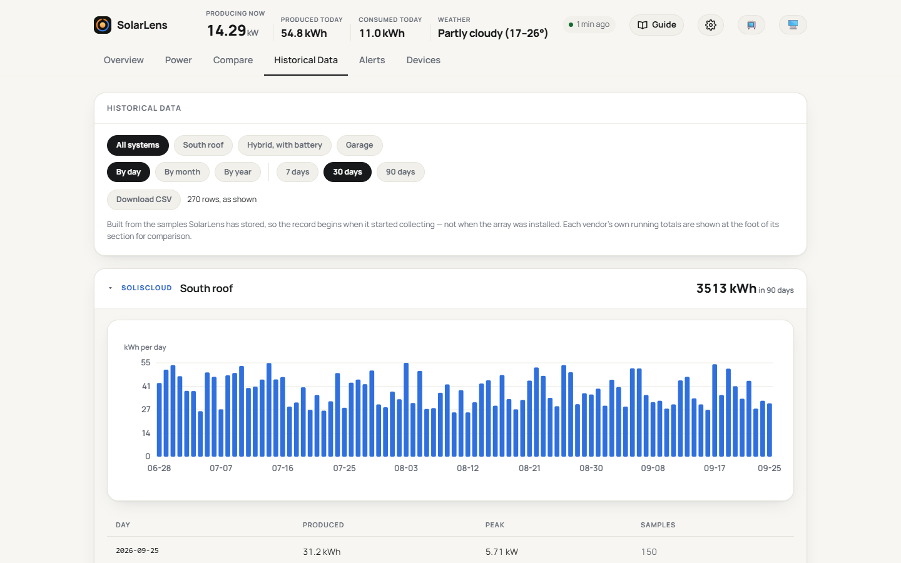 | 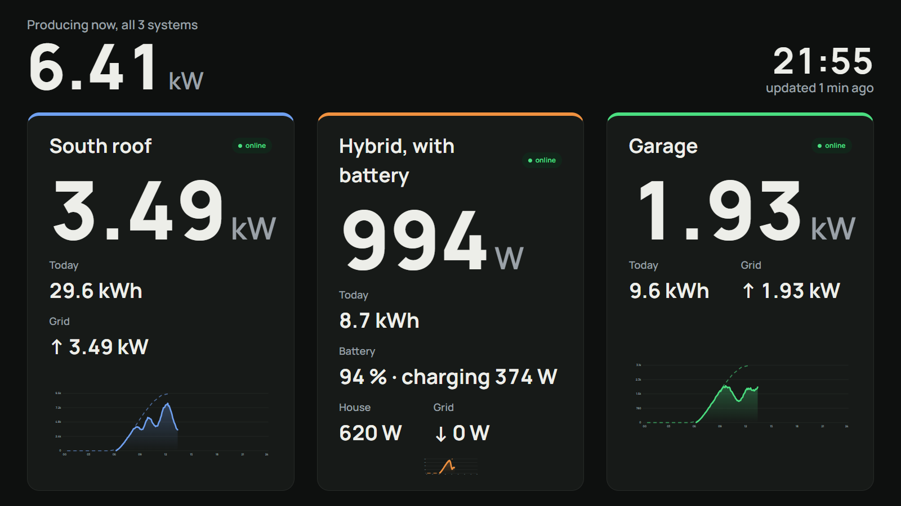 |
| 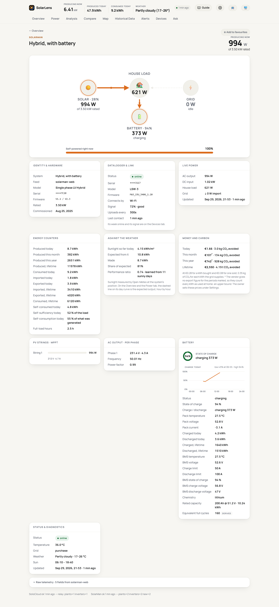 | 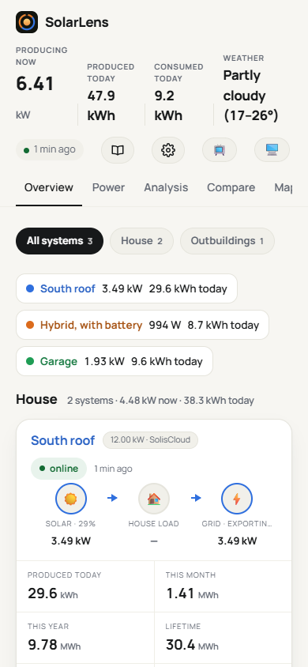 |

<sub>Screenshots of the demo: three invented systems, made-up figures. `npm run screenshots` retakes them.</sub>

- **Two vendors, one model.** SolisCloud and SolarMan are normalised into the same reading shape, so the UI never cares where a number came from.
- **Your data, kept.** Every sample is stored - its figures for good, and the untouched vendor payload for a month - so you get history the vendor apps don't let you keep or export.
- **Works with whatever access you have.** Official API keys are best; a browser-session fallback for SolarMan and a local relay agent for SolisCloud cover you while keys are pending.
- **Honest about freshness.** Every panel shows *when* it was last updated. A system reads **offline** the moment either the vendor says so or nothing has arrived for 25 minutes — and an offline system's live figures are zero, not whatever it managed just before it dropped.
- **Reads well in either theme.** A three-state toggle in the top-right corner follows your system, or forces light or dark; the choice is remembered and applied before first paint.
- **Labelled, not cryptic.** Every headline figure says what it is and what it covers — "Producing now", "Produced today", "Consumed today" — and each system's live output is set against its rated size.
- **Open it and it is there - or make it yours alone.** Out of the box, no login and no token to copy onto each device, with vendor identifiers stripped from every response before it leaves the Worker. Turn on *Require sign-in to view* and it is private: a passkey or a password, once per device, and never again; share a view-only link with anyone you choose.
- **Measured against the weather.** Each system's position comes from its vendor, and every hour SolarLens asks Open-Meteo how much sun fell there. Each system learns its own performance ratio from its recent sunny days; the day curve then carries a dashed line of what the sun allowed, the system's page sets made against expected, and an alert says when a system makes far less than its sunlight allowed - shading, dirt, a tripped string.
- **A battery's capacity, over time.** From each day's charge and how far the charge rose, the History tab estimates how much the battery holds now, against its nameplate and against the oldest days in view.
- **A day, hour by hour.** The Analysis tab takes any of the last seven days and shows what the panels made against what the house used, hour by hour: the best hour, the peaks, how much of the sun's output the house used itself, and how much of the house's use the sun covered.
- **Your systems, in your order.** Star the systems you watch and they come first; sort them into groups and the Overview shows each group under its own heading and total.
- **What the sun has saved.** Set your tariff in Settings - what a kWh costs to buy, what one earns when sold, net metering or not, and the grid's CO₂ per kWh - and each system's page says what it has saved today, this month, this year and in its life, and History adds what each day, month or year was worth. Until you set it, no money is shown at all.
- **An assistant that knows your systems.** Ask anything in your own words and follow up - "how much did I export last week?" … "and the week before?" - for an analysis, statistics, comparisons, why a day was low, any figure the records hold ("how many days was the battery full?"), a full report to download and print, what a word means, or how to do something in the app. A model chooses which figures answer it, SolarLens works out every number, and each answer comes with the tables it came from; words stating a number the figures do not hold are thrown out. The model is Workers AI by default, with nothing to host - or any server that speaks OpenAI's API, your own included - and with no model at all, SolarLens reads the question itself.
- **Ask from Claude, or any AI app.** SolarLens is an MCP server at `/mcp`: approve an app once, on SolarLens's own page, and it can ask the same read-only questions - whether the relay laptops are on or off.
- **It watches for slow decline.** Every Monday each system's output is set against the sunlight on its panels; a system making 8% less than it did - dirt, shade, a string down - is flagged and told like any alert, and a short report on the week goes out with the summary.
- **Told where you already look.** The same alerts a phone gets, and a summary every Monday morning, posted to ntfy, Telegram, Discord or any webhook - each told once, with the tokens kept encrypted. No email.
- **In Home Assistant.** The configuration written for you - power, energy today and in total, and each battery's charge, as sensors - with every other figure, online or not and today's saving among them, there to add; and a read-only token when the dashboard is private.
- **A site map, for the owner.** Where each system is, on OpenStreetMap - served to the signed-in owner and nobody else.
- **Each system's day ends where its own sun sets.** Every plant's timezone is stored, and every figure, curve and daily row is cut at that plant's midnight rather than at the reader's — so two systems in different countries are each shown their own day, on the same screen.
- **Fault history, with what the vendor advises.** Every alarm each vendor has on record, back to installation: when, how severe, the fault code, how long it lasted, and the vendor's own advice where it gives any. SolarMan's alert list says only when a fault was raised; its timeline, read for the newest alerts each hour, supplies when each one cleared, and the occurrences the list folds into one entry per day.
- **Tells your phone, even with the dashboard closed.** Turn it on once per device on the Alerts tab, and that device is notified when a system stops reporting while it was producing, when a fault is recorded, when a SolisCloud login is about to run out, or when a vendor stops answering. A system going quiet at dusk is not news, so it is not announced. While a tab is open, a second switch announces every change the Alerts tab shows.
- **Never stuck on an old version.** A tab left open across a release offers a *Reload* when a new version is out; a TV display reloads itself.
- **A guide built in.** The **Guide** button - an open book - at the top of every page opens a guide to the app: what SolarLens is, what each tab holds, a "where do I find…" table, what is new in this release, and the few things worth knowing - such as an on-grid system reading offline every night. It opens even before the data has loaded.
- **Made for a wall, too.** TV mode at `#/tv` drops the header and tabs, sizes everything to the screen, keeps the display awake, and shows a clock so a frozen page is obvious from across a room.
- **Each system on its own, or all together.** Historical Data shows every system one after the other, or - with the switch at the top - just one, with its chart, table and CSV.
- **History that goes back to the start.** Days, months or years. Months and years use each vendor's own totals, which reach back to the day the plant was installed, and every row says whether its figure is the vendor's or SolarLens's own and how many of its days SolarLens saw.
- **Installable.** Add it to a phone's home screen and it opens in its own window. The worker behind that goes to the network first and falls back to a cache only when there is none, so an installed copy can never show a stale reading as a live one. It keeps only the page and its icons, never an answer from the API, which since 3.0 depends on who is asking.
- **Tested.** Unit tests for every normaliser and unit conversion, every route and who may call it, and every cron run held to the database's per-run limit; Playwright end-to-end tests for the dashboard on desktop and mobile; integration tests against the real Worker; and a picture of every view compared on each change.

> Not affiliated with Ginlong/Solis or IGEN Tech/SolarMan. 

---

## Contents

1. [How it works](#how-it-works)
2. [Data sources and how each authenticates](#data-sources-and-how-each-authenticates)
3. [Quick start (≈10 minutes)](#quick-start-10-minutes)
4. [Getting credentials](#getting-credentials) — [SolisCloud](#soliscloud-official-api-key) · [SolarMan](#solarman-official-business-api) · [SolarMan fallback](#solarman-browser-session-fallback)
5. [SolisCloud relay agent](#soliscloud-relay-agent) — [one command on Windows](#one-command-on-windows) · [more than one machine](#running-it-on-more-than-one-machine) · [replacing a token](#replacing-a-token)
6. [Notifications on your phone](#notifications-on-your-phone) · [Alerts elsewhere, and Home Assistant](#alerts-elsewhere-and-home-assistant) · [Ask SolarLens, and the agents](#ask-solarlens-and-the-agents) · [SolarLens as an MCP server](#solarlens-as-an-mcp-server) · [Signing in, and making it private](#signing-in-and-making-it-private) · [The demo on GitHub Pages](#the-demo-on-github-pages) · [Upgrading from 2.x](#upgrading-from-2x)
7. [Configuration reference](#configuration-reference)
8. [Local development](#local-development)
9. [Testing](#testing) — [what runs on every pull request](#what-runs-on-every-pull-request) · [where the reports are](#where-the-reports-are)
10. [Data model](#data-model)
11. [HTTP API](#http-api)
12. [Project layout](#project-layout)
13. [Troubleshooting](#troubleshooting)
14. [Security and privacy](#security-and-privacy)
15. [Changelog](CHANGELOG.md) · [Handover](docs/handoff.md) · the guides: [Alerts elsewhere](docs/alerts-elsewhere.md) · [Home Assistant](docs/home-assistant.md) · [Ask SolarLens](docs/ask-solarlens.md) · [MCP server](docs/mcp.md) · [vendor API notes](docs/api-notes.md) · [against the vendor apps](docs/feature-gaps.md) · [the 3.0 roadmap](docs/roadmap.md)
16. [Roadmap](#roadmap) · [Known limitations](#known-limitations) · [Contributing](#contributing) · [License](#license)

---

## How it works

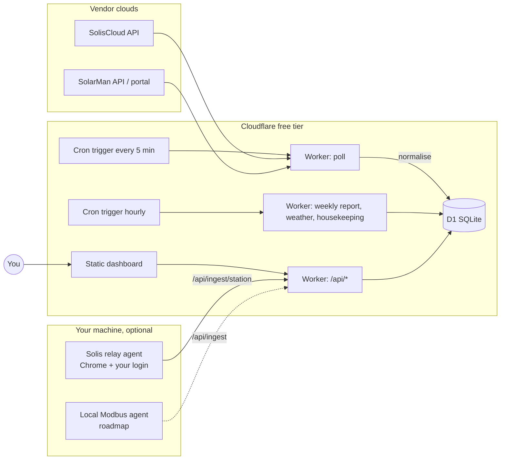

A single Cloudflare Worker does three jobs:

1. **Poller** — on a cron tick it asks each configured provider for its plants, then for each plant's live snapshot, normalises the vendor payload into one `Reading`, and inserts it (idempotently) into D1. A second cron, once an hour, does the slower work - the week's agents and summary when they are due, the weather, and the housekeeping - so the five-minute run keeps to the readings and the alerts (`src/cron.ts`).
2. **API** — a few JSON endpoints over D1: latest reading per inverter, a time series for charts, poll health, and push endpoints for local agents.
3. **Static UI** — a dependency-free, hash-routed HTML page served from the same Worker. Five tabs - six with two systems or more - plus a per-system page they all link into, and Settings behind the gear. Any number of systems: each has a colour of its own, used wherever it appears (its line, its card, its name), assigned by its place so it keeps it between visits:
   - **Overview** (`#/`) — one column per system, sized to fit a laptop screen without scrolling: the energy-flow diagram, then that system's figures as tiles, then its day curve. Producing now, house load, grid direction and battery charge live in the diagram and are not repeated as figures. Model and datalogger signal are not here at all — they never change, so they sit on Devices. Anything above the curve opens that system's detail page; the curve opens Power. Below 1080px wide the columns stack, and below 660px tall the page scrolls, because two systems will not fit on a phone and a very short window cannot hold a diagram, twelve figures and a readable curve at once.
   - **Power** (`#/power`) — the combined day curve (click a name in the legend to show or hide that line), then each system in a collapsible section carrying its full detail set: identity, datalogger, live power, counters, PV strings, per-phase AC, battery, diagnostics and raw telemetry - every measurement the vendor sent, with each id, serial, name and place left out.
   - **Analysis** (`#/analysis`) — one day of the last seven, one system or all: a bar per hour of what was made (each system in its colour) with the house's use drawn across it; what was made and used, the sun's share used at home and the house's use covered by the sun, the best hour, the peak output and draw; each system's peaks; and every hour in a table. Worked out from the power samples at each plant's own clock.
   - **Compare** (`#/compare`, with two systems or more) — every system side by side on one scale: kWh per kWp of panels today and this month as bars, then a table of size, output now (and as a share of size), today, this month, this year and lifetime, each per kWp. The same sun on the same tilt gives the same figure, so the system well below the others is the one to look at.
   - **Historical Data** (`#/history`) — day by day per system: produced, consumed, imported, exported, battery in and out, peak and sample count, with a bar per day. Columns appear only where that system measures the quantity, and the page says plainly that the record begins when SolarLens started collecting rather than when the array was installed.
   - **Alerts** (`#/alerts`) — everything either cloud says is wrong, one collapsible section per system. Nothing is invented: each row names the field it came from, so an empty section reads as "both vendors report normal" rather than "nobody looked". The tab carries a count badge.
   - **Devices** (`#/devices`) — a card per datalogger, then the hardware inventory. Each datalogger card holds everything its vendor reports about it - how it connects, signal and signal bars, upload interval, last contact, time since its last restart and in total, model, firmware, when it was made, first connected and warranty - and its last seven days: a strip of online, offline and not heard from, how often and how long it dropped, and its signal as a line on a fixed scale. Below, inverters and dataloggers with serial, model, firmware, rated power, signal strength and last contact.
   - **System detail** (`#/system/<id>`) — identity and hardware, datalogger and link, live power, energy counters, per-MPPT-string PV power, battery (hybrid only), diagnostics, and a searchable raw-telemetry table of the vendor's measurements.

   With three systems or more the Overview adds a strip above the cards - every system's name, output now and today, and "offline" where it is - and scrolls rather than squeezing them onto one screen; one or two still fit one screen. TV mode shows three systems at a time and takes turns every twenty seconds past that, with the whole fleet in the total. A plant with more than one inverter shows each of them on its system page.

   There is no Energy flow tab: the diagrams lead the overview instead, and an old `#/flow` bookmark lands there.

Every provider is an adapter behind one interface (`listPlants → listInverters → getReading`). A provider is active purely when its secrets are present, so the same deploy works with one vendor today and both tomorrow.

## Data sources and how each authenticates

| Route | Vendor | How it authenticates | Stability | When to use |
|---|---|---|---|---|
| **Official API** | SolisCloud | HMAC-SHA1-signed requests with `KeyId`/`KeySecret` | Documented, stable | Always, once Solis enables API access on your account |
| **Official Business API** | SolarMan | `appId`/`appSecret` + email + sha256(password) → bearer token (~2 months, auto-renewed) | Documented, stable | Always, once SolarMan issues your keys |
| **Web-session fallback** | SolarMan | Refresh token copied once from your browser; the Worker renews the 24 h access token itself | Unofficial; works until you log out or the portal changes | While waiting for keys |
| **Relay agent** | SolisCloud | Your logged-in Chrome session on your machine; the real portal makes the calls, the agent relays the responses | Unofficial; robust to portal releases, needs your PC on | While waiting for API access |
| Local Modbus | either | Direct LAN read of the datalogger | Planned | Second-by-second data, cloud-independent |

Why the difference between the two fallbacks: SolarMan's portal uses a plain bearer token that can be replayed from anywhere. SolisCloud's portal signs every call with a secret hidden in its JavaScript, so a copied token cannot be reused — the relay agent lets the portal itself do the signing instead. Details in [docs/api-notes.md](docs/api-notes.md).

## Quick start (≈10 minutes)

**Prerequisites:** Node.js 22.13 or newer, a free [Cloudflare account](https://dash.cloudflare.com/sign-up), and Git. `.nvmrc` pins 22, the version the automated checks use; newer versions are fine to develop on.

```bash
git clone https://github.com/<you>/SolarLens.git
cd SolarLens
npm ci
```

**1. Log in to Cloudflare and create the database**

```bash
npx wrangler login
npx wrangler d1 create solar-lens
```

That prints a `database_id`. It is not a credential — nobody can touch the
database without your Cloudflare login — but it identifies your account, so
this repository keeps it out of version control. Put it in `.dev.vars`
instead, which is gitignored:

```bash
cp .dev.vars.example .dev.vars
```

and set the line:

```
CF_D1_DATABASE_ID=<the id wrangler just printed>
```

`wrangler.jsonc` carries the placeholder `${CF_D1_DATABASE_ID}`, and
`scripts/wrangler.mjs` substitutes your real id into a temporary, gitignored
copy of the config each time you run a command. **Because of that, use the npm
scripts rather than `npx wrangler` directly** — `npm run cf -- <anything>`
passes any wrangler command through the wrapper:

```bash
npm run db:remote                 # apply the schema to the deployed database
npm run cf -- d1 info solar-lens  # the general escape hatch
```

**2. Set your secrets** — each command prompts for the value; nothing is stored in the repo.

```bash
npm run cf -- secret put API_TOKEN       # the owner's key: the sign-in setup code, and the gate on writes
npm run cf -- secret put SECRET_KEY      # what every key is derived from, so a new API_TOKEN resets nothing
npm run cf -- secret put INGEST_TOKEN    # gates the push endpoints used by local agents
```

Generate strong tokens with:

```bash
node -e "console.log(require('crypto').randomBytes(24).toString('base64url'))"
```

Keep all three somewhere you can find them again — a password manager, not a file
on the machine. Cloudflare will never show a secret back to you, so a lost
token can only be replaced, not recovered (see
[Replacing a token](#replacing-a-token)). Put the same values in `.dev.vars`
as well: the relay agent and `npm run dev` read them from there.
`SECRET_KEY` is optional but recommended: without it `API_TOKEN` does its job
too, and replacing the token then means setting the password and the alert
channels again (see [Replacing a token](#replacing-a-token)).

Then add whichever provider credentials you have (see [Getting credentials](#getting-credentials)):

```bash
npm run cf -- secret put SOLIS_KEY_ID
npm run cf -- secret put SOLIS_KEY_SECRET
# and/or
npm run cf -- secret put SOLARMAN_APP_ID
npm run cf -- secret put SOLARMAN_APP_SECRET
npm run cf -- secret put SOLARMAN_EMAIL
npm run cf -- secret put SOLARMAN_PASSWORD_SHA256
# or the SolarMan browser-session fallback
npm run cf -- secret put SOLARMAN_WEB_REFRESH_TOKEN
```

If you have neither vendor's API keys yet, that is the normal starting point —
both are approvals you have to request. Skip to
[Getting credentials](#getting-credentials) for how to ask, and use the
[SolarMan browser-session fallback](#solarman-browser-session-fallback) and the
[SolisCloud relay agent](#soliscloud-relay-agent) to have real data on screen
the same day.

**3. Deploy**

```bash
npm run deploy
```

This is the first deploy, from your own machine. Afterwards deploys happen
through the pipeline: merging to `main` runs the checks, waits for a person to
approve on GitHub, applies migrations, deploys and checks the live site - see
[what happens after a merge](#what-happens-after-a-merge).

The first deploy asks you to register a `workers.dev` subdomain (a one-time name for your account); pick one and run the deploy again. It prints your URL, e.g. `https://solar-lens.<your-subdomain>.workers.dev`.

**4. Open the dashboard**

Open `https://solar-lens.<your-subdomain>.workers.dev`. That is all — on any
phone, tablet or laptop, with nothing to copy first. Until you choose
otherwise the readings are open to anyone with the address, with vendor
identifiers stripped from every response; to make the dashboard private, set up
sign-in (below) and turn on **Require sign-in to view** in Settings. See
[Who can read, and who can write](#who-can-read-and-who-can-write) for exactly
what each choice publishes.

The first data arrives on the next 5-minute cron tick, or immediately with:

```bash
curl -X POST -H "Authorization: Bearer <API_TOKEN>" https://solar-lens.<your-subdomain>.workers.dev/api/poll
```

> **Windows PowerShell:** `&&` is not a statement separator there — run chained commands on separate lines.

## Getting credentials

### SolisCloud (official API key)

1. In the SolisCloud web portal, check **avatar → Basic Settings** for an **API Management** section. If it is there: **Activate Now** → solve the puzzle → enter the emailed code → copy `KeyId` and `KeySecret`.
2. If it is **not** there, API access is not yet enabled on your account. Open the [Solis Service Center → Submit a ticket](https://solis-service.solisinverters.com/en/support/tickets/new), choose the **Service Support Ticket** form and fill it with:
   - Product Type **Monitoring Platform**, Product Name **Solis Cloud Web**
   - Tickets Type **API Request - System Owner** (this is the "API Access Request" the guide refers to)
   - your plant ID, country, and your SolisCloud login email as the *API Account Email Address*
   - a short description: read-only monitoring for a personal dashboard, system owner, no remote control needed.
3. Once approved, API Management appears under Basic Settings. Only end users (not installers) are eligible.

Response times vary widely — use the [relay agent](#soliscloud-relay-agent) in the meantime.

### SolarMan (official Business API)

Email `service@solarmanpv.com` asking for Business API `appId`/`appSecret`. Include your SolarMan login email, your station ID, that you are the system owner (not an installer/distributor), that you need read-only monitoring for a personal dashboard, and expected usage (one request every ~5 minutes). Replies usually take a day or two.

`SOLARMAN_PASSWORD_SHA256` is the SHA-256 hex of your SolarMan password:

```bash
node -e "console.log(require('crypto').createHash('sha256').update(process.argv[1]).digest('hex'))" 'your-password'
```

### SolarMan (browser-session fallback)

1. Log in at `https://home.solarmanpv.com` in Chrome.
2. Press F12 → **Application** → **Cookies** → `https://home.solarmanpv.com`.
3. Two cookies hold JWTs (`eyJ…`). The **persistent** one (expiry months away, ~940 bytes) is the **refresh token** — copy its value into `SOLARMAN_WEB_REFRESH_TOKEN`. The **Session** one (~880 bytes) is the access token; optionally copy it into `SOLARMAN_WEB_ACCESS_TOKEN` so the very first poll needs no refresh.
4. Do not log out of SolarMan in that browser — logging out revokes the tokens.

Password login is deliberately *not* automated: the portal requires a Cloudflare Turnstile token with every password grant, and that is a human step.

## SolisCloud relay agent

SolarMan reaches the Worker on its own: its portal hands out an ordinary bearer
token that can be replayed from anywhere, so Cloudflare talks to SolarMan
directly and nothing of yours has to be running. SolisCloud cannot work that
way. Its portal signs every request with a secret buried in its own JavaScript,
so a copied token is worthless off the page that made it. Until Solis approves
an API key for your account, the way to get Solis data is to let the real
portal make the calls in a real browser and forward what comes back.

That is the relay agent: a small script that drives a logged-in Chrome on a
machine of yours and POSTs each response to `/api/ingest/station`. **It only
produces Solis data while that machine is awake.** SolarMan keeps updating
regardless.

### One command on Windows

Double-click **`setup-relay.cmd`**, or run it from a terminal:

```bash
setup-relay.cmd
```

It installs anything missing (Node, Git, Chrome, via winget), clones the
repository if it is not already there, asks for your Worker URL and
`INGEST_TOKEN`, walks you through one SolisCloud login, and registers a
scheduled task so the relay starts itself at every logon - and again within ten
minutes if it ever stops - and keeps running after you close the terminal.

It is safe to run twice, and a second run is how you update a machine: it pulls,
checks the saved login, and re-registers the task. Anything already in place is
skipped - Node, Git and Chrome that are installed, dependencies that have not
changed - and the login is checked in a hidden browser, so a machine that needs
nothing shows no window at all. A Chrome window opens only when SolisCloud wants
someone to log in. The terminal closes by itself when setup worked and stays
open when it did not, so the reason can be read. A relay task someone disabled
is left disabled. Two details it gets right that are easy to get wrong by hand:

- **No console window.** The task starts `scripts\relay-hidden.vbs`, not
  `node.exe` directly. node is a console application, so running it from a task
  puts a black terminal on screen at every logon and leaves it there. Task
  Scheduler's *Hidden* setting does not help — that hides the task from the
  Task Scheduler list — and the S4U principal that would needs an elevated
  prompt this installer deliberately does not ask for.
- **The account name comes from Windows**, via
  `WindowsIdentity::GetCurrent().Name`, rather than being assembled from
  `COMPUTERNAME` and `USERNAME`. On a domain or Entra-joined machine the user
  resolves as `DOMAIN\name` or `AzureAD\name`, and the composed version maps to
  no SID at all — registration fails with *No mapping between account names and
  security IDs was done*.

Useful switches:

| Switch | Effect |
|---|---|
| `-InstallDir <path>` | Where to put the checkout (default `%USERPROFILE%\SolarLens`) |
| `-WorkerUrl`, `-IngestToken`, `-PlantIds` | Answer the prompts up front |
| `-NoTask` | Set everything up but do not register the scheduled task |
| `-UseMyChrome` | Attach to the Chrome you already have open instead of running a second one — see below |
| `-DebugPort <n>` | Which port `-UseMyChrome` connects on (default 9222) |

### On macOS or Linux, or by hand

```bash
git clone https://github.com/<you>/SolarLens.git && cd SolarLens && npm ci
cp .dev.vars.example .dev.vars      # set SOLARLENS_URL and INGEST_TOKEN
npm run relay:solis
```

The first run opens a Chrome window on the SolisCloud login page. Sign in once;
the session is kept in `./.relay-profile` (gitignored), so later runs need no
interaction. Then set `RELAY_HEADLESS=1` in `.dev.vars` and it runs invisibly.
To keep it alive: `pm2 start agent/solis-relay.mjs --name solis-relay`, or a
`systemd --user` unit, or Windows Task Scheduler if you skipped the installer.

### How it behaves

- Every 5 minutes (`RELAY_INTERVAL_MIN`) it opens each plant page, waits for the portal's own `detailMix` response, and POSTs it. The Worker normalises it with the **same code path** as the cloud poller, so field mapping and sign conventions can never drift between the two routes.
- Set `SOLIS_PLANT_IDS` to limit it to specific plants; otherwise it relays every plant the account can see, including plants shared into it by someone else.
- Readings arrive tagged `source: soliscloud-relay`; the dashboard shows "via soliscloud-relay" under the panel.
- It reads `.dev.vars` itself, and clears its own stale Chrome profile lock if a previous run was killed.
- **It retries a failed browser launch** twice with a short backoff, and clears the `Singleton*` files Chrome leaves when a machine is shut down under it — but only when nothing holds the profile, because a live Chrome owns those files. Without this, the first cycle after a restart fails and Solis loses a whole interval: Chrome starts, exits before Playwright can speak to it, and the error is not the one a message-matching retry would recognise.
- **Hourly it also reads the plant's alarm history, and daily the vendor's own period totals**, by setting the alarm page's Status filter to Recovered and pressing Month, Lifetime and Year on the plant's chart - again waiting for the portal's own signed responses. The first cycle after the relay starts reads every page of alarms and steps back through every year of totals, which adds about a minute to that one cycle; later cycles read only the newest page and the current year. Neither step can cost the live reading: both run last and a failure is logged and skipped.
- **After every cycle it reports whether its SolisCloud login works, and when that login runs out.** A SolisCloud web login lasts exactly seven days and using it does not extend it, and the login page carries hCaptcha, so a relay cannot renew its own login: once a week, someone logs in again. The relay reads the expiry from the portal's own login cookie, so the date is exact, and the dashboard warns two days ahead on the Alerts tab and lists every relay's expiry on the Devices tab. Each relay is named by `RELAY_NAME` if you set one, such as *Office laptop*, or else *Relay 1*, *Relay 2*. It identifies itself to the Worker with a random id it keeps beside its browser profile, never the computer's name, and that id never appears on the dashboard.
- **To renew a login, double-click `renew-solis-login.cmd`** in the SolarLens folder on that computer. It stops the hidden relay, updates the code, checks the saved login in a hidden browser, and starts the hidden relay again. If the login still works, a reading goes through and nothing appears on screen. Only when SolisCloud wants a login does a Chrome window open, and it closes itself once a reading has been sent. Re-running `setup-relay.cmd` does the same check.
- **Or let the relay log in by itself.** With `SOLIS_USERNAME` and `SOLIS_PASSWORD` in `.dev.vars` - setup writes them from an installer that carries them - a hidden relay whose login has run out logs in again on its own, still hidden: it fills both in, ticks the agreement box (the owner asked for that) and presses *Login*. Only if SolisCloud then asks for a puzzle or a code does a window open, already filled in, for a person to answer it and press *Login*: that is SolisCloud's check that a person is there, and the relay never answers it. One attempt an hour at most, so a refused password is not tried until the account locks; a window stays open for up to an hour, and closing it means "not now". Both values are plain text in `.dev.vars` and in an installer made with them - keep those files on your own machines.
- **A cycle that delivers no reading counts as failed.** The portal decides whether a login is needed only after its own scripts run: with no login, the plant page stays put for about three seconds, then moves to the login page. The relay now watches until the plant list loads or the login page appears, rather than looking once at three seconds, which could call a missing login fine and report success with nothing sent.
- **The background relay is always hidden.** `scripts\relay-hidden.vbs` sets `RELAY_HEADLESS=1` for the process it starts, which beats anything in `.dev.vars`, so a `0` left there by a login done by hand can never put a Chrome window on screen at every logon.
- `RELAY_ONCE=1` runs a single cycle and exits: `0` a reading went through, `3` SolisCloud wants a login, `1` anything else. The installer and the renewal script use it, so each step ends by itself instead of asking anyone to press Ctrl+C — which on Windows raises *Terminate batch job (Y/N)?* inside a `.cmd` and strands the installer half-finished. `RELAY_SKIP_EXTRAS=1` leaves out the alarm history and period totals, which turns that check from about a minute into about twenty seconds; the background relay started straight afterwards reads them anyway.

### Running it on more than one machine

Encouraged, and the reason the ingest endpoint is idempotent. Run the same
setup on a second computer — a work laptop, a desktop that is on at different
hours — with the same Worker URL and `INGEST_TOKEN`. A reading that arrives
twice is stored once, and whichever machine is awake backfills the part of the
day the others missed. Two machines with complementary schedules cover far more
of the day than either alone.

`setup-relay.cmd` still stops three times to ask for the Worker URL, the ingest
token and the plant ids, which means carrying those values across and typing a
43-character token correctly. To skip that, generate a personalised installer
**on the machine that already works**:

```bash
powershell -NoProfile -ExecutionPolicy Bypass -File scripts\make-laptop-installer.ps1
```

It reads those three values out of your `.dev.vars` and writes
`setup-solarlens-relay.cmd` to your Desktop (or wherever `-OutFile` says) with
them already filled in. Copy it to the other machine and double-click it: it
installs what is missing, fetches the code, configures itself, and registers
the scheduled task without asking you anything.

The same file also updates a machine later. Double-clicked again, it stops the
hidden relay, pulls the new code, installs any new dependencies, checks the
SolisCloud login in a hidden browser - opening a window only if a login is
needed - and starts the relay again. If you deleted
the file, as its warning suggests, `renew-solis-login.cmd` in the SolarLens
folder updates the code, checks the login and restarts the relay without needing
the token, though it does not install new dependencies.

The one step that stays manual is the SolisCloud login, in the browser window
it opens when one is needed. That is not an omission — the relay works by
driving a logged-in browser session, and no script can type your password into
a login form for you. Everything after it is automatic, and the window closes
itself.

It reaches the code three ways, in order of how reliable they proved to be:

1. **A checkout already on that machine** — used as it stands, updated with
   `git pull` when that works.
2. **`git clone` from `github.com`** — the host that stayed up while
   `raw.githubusercontent.com` was answering 503.
3. **A single file over HTTPS from `raw.githubusercontent.com`** — last resort,
   for a machine with no git at all. When that is the situation the message says
   so and names the fix, instead of blaming a busy server.

If step 1 finds a checkout that can no longer fast-forward, it is fetched and
reset to `origin/main`. That case is not exotic: **a checkout left on a
branch that was later squash-merged**, or holding any commit that never reached
`main` in that form, has diverged from the published branch and can never
fast-forward to it. A checkout in that state would otherwise sit on stale code forever —
including a stale copy of the installer, which is how one machine ended up
unable to deliver its own fix. The reset happens **only** when `git status`
reports nothing to lose; a working tree with local modifications is left alone
with a warning.

> **The generated file contains your ingest token in plain text.** That is why
> it is written outside the repository. The token only permits pushing
> readings — it cannot read your dashboard and cannot reach your Cloudflare
> account — but carry the file on a USB stick rather than emailing it, and
> delete it from both machines once the setup is done.

### `-UseMyChrome`, and why it is not the default

By default the relay runs a Chrome of its own with its own profile. That is not
an oversight: Chrome refuses to let two programs share one profile directory, so
the agent genuinely cannot borrow the browser you are using.

`-UseMyChrome` takes the other route — it attaches over the DevTools protocol to
a Chrome you started yourself, and uses the SolisCloud login already in it. The
cost is real and worth understanding before choosing it:

- Chrome only accepts that connection if it was **started** with
  `--remote-debugging-port=9222`. The flag cannot be switched on afterwards, so
  you must close every Chrome window and relaunch it that way.
- While that port is open, any program on the machine can drive your browser and
  everything it is signed in to.
- The relay stops whenever you close Chrome.

The separate hidden browser has none of those drawbacks, which is why it is the
default. `-UseMyChrome` exists for people who would rather not have a second
browser profile at all.

### Replacing a token

Cloudflare never shows a secret back, so a token you have lost — or one that has
leaked — can only be replaced. On Windows:

```bash
powershell -NoProfile -ExecutionPolicy Bypass -File scripts\rotate-tokens.ps1 -Ingest
```

`-Ingest` sets a new `INGEST_TOKEN` in Cloudflare, writes it to `.dev.vars` and
restarts the relay. `-Api` does the same for `API_TOKEN`. Signed-in devices and
passkeys keep working through it. What else does depends on `SECRET_KEY`:

- **With `SECRET_KEY` set**, nothing else changes: the password and the places
  under *Alerts elsewhere* are keyed with it, not with the token.
- **Without it**, `API_TOKEN` is the key as well, so **the password stops
  working**: set it again afterwards - Settings, *Forgot your password?*, with
  the new token as the setup code. The places under *Alerts elsewhere*, whose
  tokens are encrypted with a key derived from it, stop too: add each again
  (Settings says which "cannot be read").

Cloudflare is updated first, so a failure leaves the old token working
everywhere rather than half-changed.

**Adding `SECRET_KEY` later** resets nothing: `npm run cf -- secret put
SECRET_KEY`, with a long random value kept with the others. Signed-in devices
renew their session under it on their next request (a refresh token is not
keyed), the password moves over the next time it signs you in, and the alert
channels at the next hourly run. Replace `API_TOKEN` only after that - one
sign-in with the password, and an hour - since until then those are still read
with it. `SECRET_KEY` itself is the one secret meant to stay put: replacing it
means setting the password and the channels again, and a SolarMan web session
if you use one.

Elsewhere, do the same three steps by hand: `npm run cf -- secret put <NAME>`,
update `.dev.vars`, restart the relay.

## Notifications on your phone

The Alerts tab has two switches. **Tell me when something changes** works while the dashboard is open in that browser. **Also when this browser is closed** reaches a phone in a pocket, through the browser's own push service, and needs setting up once:

1. **Give the Worker its signing key** — once, from the project folder on a computer with a signed-in wrangler:

   ```bash
   node scripts/make-vapid-key.mjs
   ```

   It makes the key and stores it as the Worker secret `VAPID_KEY` straight away; the private half is never printed or saved to a file. Run it again and it changes nothing; `--replace` makes a new key, after which every device has to turn notifications on again.

2. **On each phone or computer**, open the dashboard, go to the Alerts tab and press **Turn on for this device**. Signing a device up is a write, so it needs the owner: a device you have signed in on (Settings) is ready, and any other asks for the key once and does not keep it. On an iPhone or iPad, add the dashboard to the home screen first and turn this on from there; Safari allows web notifications only there.

A device that turns this on gets one message at once, so you can see the whole path work, and a **Send a test** button afterwards. Turning it off needs no key.

**What is announced.** Each rule is written for a phone, not a screen:

| Announced | When | Why it is shaped so |
|---|---|---|
| A system stopped reporting | nothing for 30 minutes after a reading that showed it producing | the on-grid system goes quiet every night because its inverter sleeps; silence only matters mid-generation |
| A fault | a vendor alarm first seen within six hours of when it began | says whether it has already cleared, and the vendor's advice unless the advice is to do nothing |
| A SolisCloud login | two days before it runs out, and when it has | names the relay as the Devices tab names it, never by its id |
| A vendor not answering | its last three polls failed, across at least fifteen minutes | one failure is weather; three in a row is usually a token |

Each is told once - however long it lasts - and again only if it clears and returns. The push carries no text: it only wakes the device, which then asks `/api/push/recent` what to show, so what a notification says never passes through Google, Apple, Mozilla or Microsoft.

## Alerts elsewhere, and Home Assistant

**Alerts elsewhere.** Settings (the gear) → *Alerts elsewhere* posts the same
alerts a phone gets - told once each - and a summary every Monday morning to
up to five places: **ntfy**, **Telegram**, **Discord**, or **any webhook**. Each
gets a test the moment it is added, and Settings shows how its last post went.
What posting takes - a bot token, a webhook address, a topic - is kept
encrypted with a key derived from `SECRET_KEY` (or from `API_TOKEN`, where
`SECRET_KEY` is not set) and never shown again. With `SECRET_KEY` set, replacing
`API_TOKEN` leaves them alone; without it, each place has to be added again. How
to set each one up: [docs/alerts-elsewhere.md](docs/alerts-elsewhere.md).

**The weekly summary** covers the seven days before Monday: the energy against
the week before (counting only the systems recorded in both), each system's
share and best day, the money saved and CO₂ avoided if the tariff is set, and
the faults. It goes once a week, from the hourly run after the week's report is
written - Monday from 08:00 on the first system's clock - or three hours after
08:00 without it, if the report could not be written; a missed Monday is caught
up at the next run. `GET /api/summary` serves the same.

**Home Assistant.** Settings → *Home Assistant* writes a `configuration.yaml`
block that reads `GET /api/sensors` every five minutes into sensors - the
fleet's power and energy, each system's power and energy today, and each
battery's charge; the same answer carries whether each system is online and
today's saving, for sensors of your own. When the dashboard is private it also
makes Home Assistant a token: a
share link, sent as a bearer token, that can only read and is taken back under
*Share to view*. Alerts can go the other way, to an automation's webhook. See
[docs/home-assistant.md](docs/home-assistant.md).

## Ask SolarLens, and the agents

The **Ask** tab is a conversation with SolarLens - the chatbot - behind which
the assistant does what a question asks, and the agents work on their own every
Monday. All of it is there to answer and to analyse: *"Analyse the last 30
days: what should I do?"* reads the figures together and says what stands out,
why, and what to do - a battery kept full while the nights are bought, power
sold at midday and bought at night, an always-on load, a system slowly making
less for its sunlight, one short per kWp, a datalogger offline, a fault that
keeps coming back. Ask in plain words, and
follow up: *"How much did I export last week?"* … *"and the week before?"*,
*"Statistics for the last 30 days"*, *"Compare my systems per kWp last month"*,
*"Graph PV against load today"*, *"Which hours do I buy from the grid?"*,
*"What is the PV1 voltage?"*, *"How many days was the battery full?"*, *"When
did I first buy more than 2 kW?"*, *"What is kWp?"*, *"A report on last month"*,
*"How do I get alerts on Telegram?"* - examples, not a menu: any question about
the systems is read for what it asks. A model chooses which of sixteen
read-only tools answer the message - up to three at once;
the Worker runs them and works out every figure; the model puts them in words,
which are thrown out for the tools' own if they state any number the figures do
not hold. Each answer shows its tables, a chart where one helps - lines for a
graph of power, load, grid, battery or charge over up to three months, or of
the average day hour by hour - the period, how fresh the data was, and who
worded it. **Download** keeps any answer as a
page of its own - a report most of all, which prints to a PDF.

The model is Workers AI on Cloudflare unless `AI_BASE_URL` names another:
OpenAI, Groq, OpenRouter, or a model on your own computer behind a tunnel - any
server that speaks OpenAI's chat API. Anyone who can see the dashboard can ask;
someone signed in (the owner, or a share link) gets the model, and anyone else
SolarLens's own reading of the question - as does everyone when there is no
model, or none of the day's calls left. A daily cap, `AI_DAILY_CALLS` (100),
keeps inside Workers AI's free allowance, and a question from anyone not signed
in covers a year at most, so a stranger cannot make one answer read the whole
history. The conversation stays in the browser tab; the Worker keeps none of it.

Every Monday, a **health check** sets each system's output against the sunlight
on its panels, week by week; a fall of 8% or more over a few weeks is flagged
and told like any other alert. A **weekly report** follows, in a few sentences,
and goes out with the weekly summary; a run that fails - a model that does not
answer, a database that refuses - is tried again the next hour, three times at
most. And beside a low day on Historical Data,
**Why?** explains it: the sunlight against usual, stretches with no readings,
faults, or a system that made less than its sunlight allowed.

How it works, what the model sees, where it can run, and how to set it up:
[docs/ask-solarlens.md](docs/ask-solarlens.md).

## SolarLens as an MCP server

AI apps outside SolarLens - Claude, an IDE, anything that speaks the Model
Context Protocol - can ask SolarLens the same questions as the Ask tab, through
the MCP server at **`https://<your SolarLens>/mcp`** (Settings → Connected
apps shows it). It offers the same sixteen read-only tools - analysis, reports, statistics,
any figure the records hold, a day's power, charts of any measure, what the
inverter shows, the battery, outages and help with the app among them - runs inside the Worker on Cloudflare, and
answers whether the relay laptops are on or off. An app like Claude then works
as a chatbot over your systems, with SolarLens working out every figure.

The first time an app connects, it opens SolarLens's approval page: sign in if
asked, check where the answer will be sent, and **Allow**. The app then stays
connected - its tokens renew themselves - until you disconnect it under
Connected apps. Only the owner, signed in on that browser, can approve an app;
an app can read and nothing more. OAuth 2.1 with PKCE and dynamic registration,
as the MCP authorization spec asks: see [docs/mcp.md](docs/mcp.md).

## Signing in, and making it private

SolarLens 3.0 has an owner login. It changes nothing until you use it: the
dashboard stays open to anyone with its address until you switch that off.

1. **Set up.** Open the dashboard, press the **gear** (Settings), and use
   *Set up sign-in*: the setup code is your `API_TOKEN`, and a password of at
   least twelve characters - or none, if you will use passkeys only.
2. **Add a passkey** (recommended) under Settings → Passkeys, on each phone or
   computer you use: a fingerprint, a face or the device PIN, and nothing that
   could sign anyone in is kept on the server. A passkey signs in only when it
   is unlocked that way - a touch alone is refused - and is never locked out.
3. **Turn on _Require sign-in to view_** in Settings. From then on the readings
   need a sign-in. It cannot be turned on before a password or a passkey exists,
   so you cannot lock yourself out.

**You sign in once per device.** The browser gets a one-hour session and a
refresh token good for a year; when the hour is up, the next request renews
both on the way, so the dashboard, the TV screen and the service worker never
see a sign-in page again. Opening SolarLens at least once a year keeps a device
in. A copied refresh token is caught - the real one moves on at every renewal,
and the old one turning up later signs that device out - and only hashes of
tokens are stored.

**Settings also has:** every signed-in device, with *Sign out* for one or for
all but this one, taking effect at once; changing or removing the password; and
**Share to view** - a link that lets someone see the dashboard and change
nothing, for a day, a week, a month or until you take it back. Taking it back
signs out everyone who used it.

**What keeps working without a sign-in:** the relay laptops (they carry
`INGEST_TOKEN`), phone notifications (a device signed up for them is known by
its own push address), and `/api/status`, which says only how fresh each feed
is, for a monitor.

**Locked out?** *Forgot your password?* on the sign-in page takes the setup code
(`API_TOKEN`) and a new password, and signs every other device out. Five wrong
tries from one address lock it out for a quarter of an hour, and thirty from
everywhere in an hour pause password sign-in for an hour; passkeys still work
through both. The setup code is held to the first limit only: a stranger's
thirty wrong passwords can pause the password, but never the setup code from
your own address.

**The 2.x unlock link is retired.** `/auth?t=<API_TOKEN>` put the key to
everything into an address, where the browser's history, request logs and
anything it was pasted into keep it. It now signs nothing in and says where to
go instead: type the same token as the setup code, sign in with a passkey or
the password, or open a share link on a screen that only needs to view.

## The demo on GitHub Pages

[muhammadmobi.github.io/SolarLens](https://muhammadmobi.github.io/SolarLens/) is the dashboard as
it ships, with no server behind it. `scripts/build-demo.mjs` copies `public/` into `site/`
and adds `demo/demo.js`, which runs before the dashboard's own script and answers every
`/api` and `/auth` request with sample data made up in the visitor's browser: three invented
systems, placed each time wherever it is early afternoon, so the day's curve is always there to
see. Nothing in it came from a real plant, and nothing a visitor changes is saved.

```bash
npm run demo:build     # site/, the same thing Pages publishes
npm run screenshots    # retake docs/screenshots/*.png, of the demo
```

`.github/workflows/pages.yml` builds and publishes it whenever `public/` or `demo/` changes on
`main`. It needs Pages turned on once, with **GitHub Actions** as the source (Settings →
Pages). The demo's sample data is held to the real Worker's answers field by field
(`tests/unit/fixture-contract.test.ts`), and `tests/e2e/demo.spec.ts` opens the built site
under a sub-path, as Pages serves it, and checks every view draws, no request leaves for a
server, and nothing reaches for the root of the site.

## Upgrading from 2.x

3.0 changes nothing you rely on until you choose to: the dashboard stays open to
anyone with its address, the relays and phone notifications carry on as they
were, and each new feature waits to be set up.

1. **Deploy it as usual.** Merging to `main` runs the deploy once you approve
   it: a restore point, the nine new migrations (0014 to 0022), the Worker, and
   a check of the live site. By hand: `npm run db:remote`, then
   `npm run deploy`. The migrations add tables, columns and an index, 0021
   turns round the SolarMan battery readings 2.x stored with charging as
   discharging, and 0022 drops one index that repeated the readings table's
   own key; no table or column is dropped, so rolling the Worker back to 2.x
   still runs against the 3.0 database. 2.x would store charging the wrong
   way again, though, and 0021 - applied already - does not run twice: after a
   rollback, run it once more by hand when 3.0 is back
   (`npm run cf -- d1 execute solar-lens --remote --file migrations/0021_battery_sign.sql`),
   which turns round what 2.x stored and changes nothing else.
2. **If the deploy fails on the `ai` binding** with an authentication error,
   give the Cloudflare API token the deploy uses (the `CLOUDFLARE_API_TOKEN` of
   the `production` environment) the *Workers AI* permission. The assistant
   needs nothing else: it keeps inside Workers AI's free allowance.
3. **Set `SECRET_KEY`** - recommended, and best before you set a password:
   `npm run cf -- secret put SECRET_KEY`, with a long random value kept with the
   others. Every key is derived from it rather than from `API_TOKEN`, so a new
   `API_TOKEN` resets nothing: see [Replacing a token](#replacing-a-token).
4. **Sign in, once per device - if you want to.** Settings (the gear) → *Set up
   sign-in*, with your `API_TOKEN` as the setup code, then a passkey on each
   phone and computer: [Signing in, and making it private](#signing-in-and-making-it-private).
   The 2.x `/auth?t=…` link no longer signs a browser in, and the cookie it
   left - the token itself - is no longer accepted and is cleared, so a
   browser that used it signs in once.
5. **Make it private - again, only if you want to.** Before turning on *Require
   sign-in to view*, sign in once on each screen that shows the dashboard - the
   TV included - or open a share link on it; and give Home Assistant, or
   anything else that reads `/api`, a share link's token (Settings → Home
   Assistant makes one). The relays, phone notifications and `/api/status` keep
   working without a sign-in. On Cloudflare's free plan it also keeps strangers
   from spending the database's daily reads; a dashboard left open can have
   the optional rate limit instead (`RATE_LIMIT`, in the
   [Configuration reference](#configuration-reference)).
6. **Set up what is new**, each optional and each in Settings: the tariff (money
   saved and CO₂ avoided), groups, *Alerts elsewhere* and the Monday summary,
   Home Assistant, and connected AI apps. The assistant, the weather and
   expected output, the site map and the health check need nothing: they start
   on their own.

**What behaves differently:**

- **Replacing `API_TOKEN`** without `SECRET_KEY` means setting the password
  again and adding each place under *Alerts elsewhere* again, since both are
  keyed with it; with `SECRET_KEY`, nothing but the token changes. Signed-in
  devices, passkeys and connected apps carry on either way.
- **Reads are no longer cached** (`Cache-Control: no-store`): an answer now
  depends on who is asking.
- **A second cron**, once an hour at seven minutes past, does the slower work -
  the weekly agents and summary, the weather, the housekeeping - which rode on
  the five-minute run in 2.x. `wrangler.jsonc` lists both, and a deploy
  registers them.
- **A reading keeps its vendor payload for 30 days**, then only its figures:
  the payload was most of the database. The first runs work through the
  backlog, a day of readings an hour.
- **A Worker with no `API_TOKEN` refuses every write** (503) instead of taking
  it from anyone.
- **The Worker has no preview addresses** (`preview_urls: false`): each would be
  another public host serving it, with the production database behind it.

**If you run this repository's own workflows**, as a fork: turn on GitHub Pages
with *GitHub Actions* as its source, for the demo; allow GitHub Actions to create
and approve pull requests (Settings → Actions → General), for the owner's
auto-approval; and add a `SOLARLENS_URL` repository secret, for the production
watcher.

## Configuration reference

Secrets go in with `npm run cf -- secret put NAME` (production) or in `.dev.vars` (local, gitignored — copy from `.dev.vars.example`).

**Read by the Worker, in Cloudflare:**

| Name | Required | Purpose |
|---|---|---|
| `API_TOKEN` | for sign-in and writes | The owner's key: the setup code for sign-in, and a bearer token for the write routes. Without it nothing can be written - every write answers 503. Without `SECRET_KEY` it is the key secret too, and replacing it means setting the password and the alert channels again. |
| `SECRET_KEY` | recommended | The key secret: the session cookies are signed, the password keyed, and the alert channels and the vendors' cached tokens sealed with keys derived from it. It never travels, so replacing `API_TOKEN` resets none of those. Unset, `API_TOKEN` does the job. Set it once and keep it - see [Replacing a token](#replacing-a-token). |
| `INGEST_TOKEN` | for agents | Gates every `/api/ingest` route: the relay's readings, hardware, alarms, totals, day curves and reports on itself. |
| `VAPID_KEY` | for notifications to a closed browser | The Web Push signing key, a private P-256 JWK. Made and stored by `node scripts/make-vapid-key.mjs`; never typed by hand. Unset, the Alerts tab says notifications to a closed browser are not set up. |
| `SOLIS_KEY_ID`, `SOLIS_KEY_SECRET` | Solis official | From SolisCloud API Management. Present = the Worker polls Solis directly and the relay becomes optional. |
| `SOLARMAN_APP_ID`, `SOLARMAN_APP_SECRET`, `SOLARMAN_EMAIL`, `SOLARMAN_PASSWORD_SHA256` | SolarMan official | From SolarMan support + your login. |
| `SOLARMAN_WEB_REFRESH_TOKEN`, `SOLARMAN_WEB_ACCESS_TOKEN` | SolarMan fallback | Used only when the official keys are absent. |
| `AI` (the `ai` binding in `wrangler.jsonc`) | for the assistant's model | Workers AI. Without it (and with no `AI_BASE_URL`), SolarLens reads each question itself and the agents write from the figures alone. |
| `AI_MODEL` | optional | Another Workers AI chat model; default `@cf/meta/llama-3.3-70b-instruct-fp8-fast`. With `AI_BASE_URL`, the model name that server knows. |
| `AI_BASE_URL` | optional | A server that speaks OpenAI's chat completions API, used instead of Workers AI: `https://api.openai.com/v1`, Groq, OpenRouter, or your own model behind a tunnel. https only, but for a model on the same computer. See [docs/ask-solarlens.md](docs/ask-solarlens.md#where-the-model-runs). |
| `AI_API_KEY` | with `AI_BASE_URL` | That server's key, sent as a bearer token and never logged. |
| `AI_DAILY_CALLS` | optional | Model calls a day, every feature together, 0 to 10,000; default 100, well inside the free 10,000 neurons. |
| `INCLUDE_PLANTS` | optional | Comma-separated vendor plant/station ids to poll. Unset = every plant visible to the accounts, including plants shared into them. |
| `RATE_LIMIT` (the `ratelimits` binding in `wrangler.jsonc`) | optional | Holds callers who are not signed in to a rate per address - 120 requests a minute in the commented example - so a flood of anonymous requests cannot spend D1's daily allowance; past it, `429` with `Retry-After`. Signed-in callers and the relays are never held back. Off until uncommented, since not every plan has the binding. |

**Read locally only, from `.dev.vars` — never sent to Cloudflare:**

| Name | Used by | Purpose |
|---|---|---|
| `CF_D1_DATABASE_ID` | `scripts/wrangler.mjs` | Your D1 id, substituted into a temporary config so the real one stays out of git. Every `npm run` wrangler script needs it. |
| `SOLARLENS_URL` | relay agent | Where to POST readings, e.g. `https://solar-lens.<your-subdomain>.workers.dev`. |
| `SOLIS_PLANT_IDS` | relay agent | Which Solis plants to relay. Unset = all of them. |
| `RELAY_HEADLESS` | relay agent | `1` runs the relay browser invisibly. The background task always runs hidden whatever this says; the installer and `renew-solis-login.cmd` set it for their own checks. Only matters when running the relay by hand. |
| `RELAY_NAME` | relay agent | A nickname the dashboard uses for this relay, such as `Office laptop`. Shown publicly, so keep it vague. Unset = *Relay 1*, *Relay 2*. |
| `RELAY_CDP` | relay agent | Attach to an already-running Chrome, e.g. `http://127.0.0.1:9222`, instead of starting one. Set by `setup-relay.cmd -UseMyChrome`. |
| `CAPTURE_MINUTES` | `scripts/capture-portals.mjs` | How long a capture session runs (default 9); 25 gives time to log in first. |
| `CAPTURE_CDP_PORT` | `scripts/capture-portals.mjs` | Opens the capture window's debugging port, so a second script can drive the same window. |
| `RELAY_INTERVAL_MIN` | relay agent | Minutes between pushes (default 5). |
| `RELAY_ONCE` | relay agent | `1` runs one cycle and exits: `0` sent, `3` needs a login, `1` other failure. Used by the installer and `renew-solis-login.cmd`; not set in normal running. |
| `RELAY_SKIP_EXTRAS` | relay agent | `1` skips alarm history and period totals, for a quick login check. Not set in normal running. |
| `RELAY_PROFILE` | relay agent | Where the relay's own Chrome profile lives (default `./.relay-profile`). |
| `CHROME_PATH` | relay agent | Explicit Chrome binary, if it is not in a standard location. |

### How often anything actually happens

The intervals, easily confused:

| What | How often | Set where |
|---|---|---|
| Worker polls the vendor clouds | 5 min; past four plants a vendor, each run reads a share and every plant is read at least every 15 min | `triggers.crons` in `wrangler.jsonc`; `PLANTS_PER_RUN`, `MAX_GROUPS` in `src/poll.ts` |
| The hourly run: the weekly agents and summary when due, the weather, the housekeeping | 1 hour, at seven minutes past | `triggers.crons` in `wrangler.jsonc`; `HOURLY` in `src/cron.ts` |
| Relay agent pushes Solis readings | 5 min | `RELAY_INTERVAL_MIN` |
| Alarm history is re-read (both vendors) | 1 hour | `EXTRAS` in `agent/solis-relay.mjs`; `HOUR` in `src/poll.ts` |
| Vendor period totals are re-read (both vendors) | 1 day | `EXTRAS` in `agent/solis-relay.mjs`; `DAY` in `src/poll.ts` |
| Open dashboard re-fetches | 10 min, and never in a hidden tab | `REFRESH_MS` in `public/index.html` |
| The health check and the weekly report | Once a week: the first hourly run from Monday 08:00 on the first system's clock; a run that fails is tried again the next hour, three times at most | `runWeeklyAgents`, `MAX_TRIES` in `src/agents.ts` |
| Weekly summary to the places that take it | Once a week: the hourly run after the week's report is written, or three hours past Monday 08:00 without it | `SEND_DOW`, `SEND_HOUR`, `REPORT_WAIT_S` in `src/summary.ts` |
| Weather is fetched from Open-Meteo | 1 hour per system with a position (three months back the first time) | `refreshWeather` in `src/weather.ts` |
| A reading's vendor payload is cleared | After 30 days; a day of readings each hour | `RAW_KEEP_S` in `src/db.ts` |

A system is drawn as offline once its newest sample is older than
`STALE_AFTER_S` (25 min). That figure has to stay comfortably above the poll
interval, or a perfectly healthy inverter reads as offline in the minutes
before the next poll.

## Local development

```bash
cp .dev.vars.example .dev.vars   # fill in what you have
npm run db:local                 # schema into the local D1
npm run dev                      # http://localhost:8787
```

`npm run seed:local` inserts a day of synthetic readings so the UI has something to draw without any credentials. To run a cron by hand, start the Worker with `npm run dev -- --test-scheduled` - wrangler serves `/__scheduled` only then: `http://localhost:8787/__scheduled` runs the five-minute cron, and `http://localhost:8787/__scheduled?cron=7+*+*+*+*` the hourly one, since the Worker tells the two apart by the expression it is given. Then inspect rows with:

```bash
npm run cf -- d1 execute solar-lens --local --command "SELECT * FROM readings ORDER BY ts DESC LIMIT 5"
```

> On Windows, quoting a SQL string through the npm script can lose the quotes and turn `>` into a redirect. If a query behaves strangely there, put it in a `.sql` file and use `--file`, or call `npx wrangler … --config .wrangler.local.jsonc` directly once the wrapper has generated that file.

`npm run probe:solis` signs and sends a single `userStationList` request with the keys in `.dev.vars` and prints the raw response — the fastest way to confirm your Solis key works before it goes near the cron.

## Testing

```bash
npm test                    # typecheck + unit + e2e — the whole gate
npm run typecheck           # tsc over src/ and tests/
npm run test:unit           # vitest
npm run test:unit:watch     # vitest, re-running as you edit
npm run test:unit:coverage  # vitest + v8 coverage, enforces thresholds
npm run test:e2e            # playwright
npm run test:e2e:ui         # playwright's inspector, for stepping through a failure
```

**909 unit tests**, **596 end-to-end tests** (298 specs across a desktop and a mobile project, plus seven that retake the README's screenshots on request), **13 integration tests** against the real Worker (`npm run test:integration`) and **12 screenshot comparisons** (`npm run test:visual`), all runnable on a laptop with no Cloudflare account, no database and no vendor credentials.

### Debugging a failing test

Each test's name is a sentence saying what it holds the code to, so a failure
reads as the promise that broke. To look closer:

```bash
# One unit test file, or one test in it by part of its name
npx vitest run tests/unit/push.test.ts
npx vitest run tests/unit/push.test.ts -t "dusk"

# One end-to-end spec, in one browser project, with the browser visible
npx playwright test tests/e2e/guide.spec.ts --project=chrome --headed

# Step through it line by line, or pick tests from a window
npx playwright test tests/e2e/guide.spec.ts --project=chrome --debug
npm run test:e2e:ui
```

A failed end-to-end test leaves a trace in `test-results/`. Open it with
`npx playwright show-trace test-results/<test>/trace.zip`: it replays the test
step by step, with the page, the network and the console at every step. On CI
the same traces are in the run's `playwright-report` artifact. For coverage,
`npm run test:unit:coverage` writes `coverage/index.html`, which shows the
exact lines no test reaches.

### The frameworks, and why each

| Layer | Tool | Runs against | Why not the other one |
|---|---|---|---|
| Types | `tsc`, two projects | `src/` and `tests/` | Catches shape drift before a test can even start. The specs import the Worker's own `Reading` and `Metrics`, so changing a field breaks compilation rather than one assertion in the browser. |
| Unit | Vitest | Pure modules and the vendor clients: unit scaling, both normalisers, the call queue, day-curve backfill, PII stripping, log redaction, the public-view redactor, and request signing, token refresh and error handling against a stubbed `fetch` | Fast, no browser. These are the parts where a wrong answer is silent — a sign convention or a `kW`/`W` slip looks perfectly plausible on screen. |
| End-to-end | Playwright | The real `public/index.html`, served statically, with `/api/*` stubbed | The UI is a single dependency-free file with no components to unit-test. What matters is what a person sees, so that is what is asserted. |

### Unit tests — `tests/unit/`

Forty-two files, one concern each. Twenty-four drive the Worker or its database layer against a real database, through the helpers in `tests/helpers/`; the rest are pure-function tests against fixtures shaped like real vendor payloads:

- **`helpers/d1.ts`** — SQLite behind the D1 interface, with the project's own migrations applied. D1 *is* SQLite and Node ships one, so the SQL a test exercises is the SQL that runs in production. It also refuses a bound value D1 would refuse, which is how a `undefined` reaches a test rather than a deploy.
- **`helpers/worker.ts`** — the Worker's exported fetch and cron handlers, called with that database, a stub for the static-assets binding and whichever tokens the case is about; either cron, by its expression.
- **`helpers/passkey.ts`** — a pretend authenticator with real P-256 and RSA keys: it makes passkeys and signs challenges the way a phone or a security key does, so the Worker's verification is tested against genuine signatures.

- **`units.test.ts`** — the paired value/unit fields the vendors use (`power` + `powerStr`), `kWp`/`MWh` scaling, numeric strings, and epoch milliseconds vs seconds. A missing unit means watts rather than an invented factor.
- **`normalize.test.ts`** — both vendor normalisers end to end: SolisCloud's signed-API and relay payloads, SolarMan's station snapshot and `v3/detail` register categories. This is where the conventions are pinned down — `grid_power_w` positive on import, `battery_power_w` positive on charge, under 50 W of battery drift reading as idle, an on-grid plant getting no battery at all, and the state/status mappings for both clouds. SolarMan's live snapshot sends `chargePower` negative while charging, and it is read as charging; migration 0021 turns round the charging readings 2.x stored as discharging, touching nothing else and changing nothing when run again.
- **`queue.test.ts`** — the rate limiter that stands between a cron run and a SolisCloud ban: calls stay in order, the minimum gap is a floor, and one failed call does not strand the ones behind it.
- **`history.test.ts`** — the day-curve backfill: the shapes the chart payload has been seen in, epoch-ms/epoch-s/datetime timestamps, trailing zero padding trimmed but an interior zero kept, and rows missing either half skipped rather than guessed at.
- **`logging.test.ts`** — what is cut out of a vendor error before it is persisted, and just as importantly that an ordinary log line passes through untouched.
- **`clients.test.ts`** — all three vendor HTTP clients against a stubbed `fetch`: SolisCloud request signing, SolarMan token acquisition and refresh-and-retry, the browser-session refresh flow, the alert and period reads, error envelopes and HTTP failures; SolarMan's plants read page by page, fifty at a time; and a timeout on every call all three make.
- **`public-view.test.ts`** — what a public response may carry: systems named by alias, serial numbers masked, and no vendor plant id anywhere, including inside an alarm's internal id. Also the two things made from the raw payload: the alert fields as named columns (a SolisCloud zero kept apart from a vendor that sends no counter), and the telemetry table, which keeps only fields on a reviewed list of measurements - so the ids, the owner's notes, the platform codes and the zone name a live plant record carries are all left out, and so is any field nobody has reviewed, whatever it is called. Device rows are named by a positional alias ("s1-datalogger-1") rather than their serial.
- **`datalogger.test.ts`** — everything a datalogger reports: its link read from the model name (and left unknown rather than guessed), SolisCloud's signal bars, restart and working time and make date, the operator, cell and MAC address kept apart and never published; and the link history - a row the first time, on each change of status, on a signal move beyond its jitter (3 dBm, 5 points), and hourly otherwise, the window opened by the row before it, and 90 days kept.
- **`auth.test.ts`** — the owner login through the Worker, with a cookie jar and a moving clock: setup with the setup code, the password and its lockout (per caller and for everyone), the session renewed silently when its hour is up and a device kept in across a year of occasional use, two tabs renewing at once without signing either out, a copied refresh token signing the device out, sign-out at once for one device or all others, the *require sign-in* switch and what stays open with it on (the relays, `/api/status`, the notification reader), share links that read and never write and are taken back with their viewers, passkeys through the routes, a logger's network handles for the owner only, and `private` caching; the 2.x `/auth?t=` link signing nothing in; a sign-in challenge handed to anyone without writing a row, one this server did not sign refused, and a passkey only touched, not unlocked, refused; the setup code still letting the owner in from their own address while password sign-in is paused for everyone; and `SECRET_KEY` - a password moved over at its next use and kept through a new `API_TOKEN`, and without it a new token still meaning a new password.
- **`webauthn.test.ts`** — passkey verification against real signatures: CBOR, DER and COSE, both ES256 and RS256, and each refusal an attacker would try - another challenge, another origin, another site, no touch, a replayed registration, a key that is not the passkey's, a counter that went backwards.
- **`weather.test.ts`** — each system's position: read from both vendors' field names and range-checked, kept when a record carries none, served to the owner and nobody else, and absent from every public answer; the weather: asked for at the position rounded to about a kilometre, stamped at the end of each hour, only hours that have happened, three months the first time and an hour after, one failing position not stopping the rest; and the expected output: the ratio as the median of full sunny days, a typical one until three exist, today's curve and total.
- **`oauth.test.ts`** — an app connected to the MCP server: discovery, and CORS where it belongs and not on the approval page; registration - public clients, redirects only to https, this computer or a native app's scheme, at most a hundred, one never approved cleared after an hour; the approval page - a link it cannot trust answered on the page, anything else sent back to the app, anyone but the owner's own browser asked to sign in, the app's name kept as text and where its answer goes shown; tokens - PKCE, the wrong verifier, another app or address, a late code, a code used twice disconnecting the app, renewing for a year, a request crossing its own renewal let through and a copied refresh token disconnecting; revocation; the endpoint taking nothing but an app's token; and Connected apps in Settings.
- **`mcp.test.ts`** — the MCP server: initialize and its protocol version, ping and notifications, the tools listed as read-only with their JSON Schema, a call answered as text and structured content, a bad question as a tool error, the JSON-RPC errors, batches, and no event stream or session.
- **`tools.test.ts`** — the read-only tools: a period the way a person means it, on the plants' calendar; arguments checked, tidied and described as JSON Schema; energy per day, week, month and year, with the vendor's month totals before SolarLens began, the best and lowest period, exports and which system does not report them, and the money by the tariff; systems per kWp; faults; the state right now, with what the house draws and which way the grid flows; why a day was low - a gap in the readings, less sun, a fault, a system short of its sunlight, or an ordinary day; a system slowly making less for its sunlight; the statistics - average and median day, best and worst, spread, capacity factor, low days, and the days before - over whole days only, a first evening with one reading of nothing named and left out, as it is from energy's best and lowest day; a report made of all of them, with its headline figures; a day's power - what was made between two times from the day counter, the peak, a cloud's sharp drop and how much the power went up and down, hour by hour; outages - a stretch of daylight with no readings, one still going, the night not counted, a long silence said in days, and why - the plant's datalogger offline, the relay silent or its login run out, or the relay cleared while it still reports, with its login date; the battery - its charge now, what it took in and gave out, its lowest and highest, one battery silent and one reporting only its charge; the money saved, or that no tariff is set; how much was used at home and how much the sun covered, over the systems that report it; days above and below an amount; an inverter's temperature as last read; a chart of any measure - the systems added together every hour, a total a system would leave short left out and named while one asleep adds nothing, a second measure beside the first and how often it was above, the grid and the battery said by their direction with a battery's drift left out, the average day with its hours as spans, a week from Monday, the highest or lowest reading, a battery's charge averaged, bars for one measure day by day, three months at most, and a system with no readings of a measure named; what the inverter shows - each string, phase and the battery's own readings, a weak string named (or two), strings that cannot be compared because the readings are old or none is producing, a record with parts missing, and a system with no record; an analysis - a battery kept full while the nights are bought and one that runs low, power sold that the house could use and what it is worth by the tariff, an always-on load, the systems per kWp, the lowest day put down to the sun, to one system alone or to a system short of its sunlight, a fall the weather explains told from a system slowly making less, a system down with its datalogger or the relay said, a fault active or coming back, a weak string, a day recorded only from the afternoon left out, and what needs a look first; any figure - the days a battery was full with a system that has none left to a note, the first time the grid was bought from above an amount and how often it was sold to, energy day by day with every system together, each weekday's average, a moment's highest and when, what each inverter has made since it was installed and one with no counter, a day's figure by the hour given as the moment's, buying and selling, charging and discharging said as such, a single day or a span named as asked, never told from no record, and every measure every way by every step with no gap in its words; and how to do something in the app, or what a word means, from the guide's own entries - figures made up to be checked by hand.
- **`assistant.test.ts`** — the assistant: a question read without a model - its kind, its period (a month by name, last year's when it is still to come; a date; a year), a time of day (between two times, one side of one, "this afternoon", midnight at the end) and its system, by name or by one word only its name has; questions as owners type them, slips and all, read as meant, while a word near one it routes on - "expected", "warning" - is left alone; a day's hours kept through a follow-up; the battery, the money, the share used at home, a temperature, a count of days above an amount, "is it online" and the relay's login each routed to what answers it; a graph of any measure - the measures in the order named, the step, the highest or lowest, the last few days - with a graph of energy left to the energy tool's bars; the usual day hour by hour ("when does my load peak", "which hours do I buy"); PV1, the strings, the grid's frequency, the power factor and the battery's own readings, each to the part of the inverter asked about; a call for analysis - "analyse", "insights", "how is my system doing", "how can I improve" - with "doing right now" left to the moment and a report to its figures; any question, written every which way - a bank of an owner's questions each reaching what answers it, the figure a question asks for read as the measure, how, by what and its amount (watts as kW, selling and discharging below zero, "full" and "empty" as the battery's), short forms written out and two letters swapped mended, the first period named and a second set against it, two questions in one message, a word asked about, and a greeting or thanks answered as such; a question about tomorrow told there is no forecast; a follow-up moving the answer before to another period, the one before (a whole month, year or week, or as many days again, from the period the tool actually covered) or another system; the conversation checked as sent; with a scripted model, up to three calls chosen and run, a report worded and held to every figure it used, a reply of the model's own with a figure in it set aside; the provider - Workers AI, a server that speaks OpenAI's API over https (or on the same computer) with its key, or none; and the cap shared by every turn.
- **`ask.test.ts`** — one question at a time, through the assistant: the model's choice made from today, the systems and the tools, and checked; the figures worded, and a sentence with a number of the model's own set aside; a chatty reply, a question about something else, a bad choice, no answer; the daily cap, per UTC day; a stranger answered by SolarLens reading the question itself; and a tool asked for directly, answered in the tool's own words - or refused in them when its arguments cannot answer.
- **`agents.test.ts`** — the weekly agents: a system slowly making less flagged and one steady not; the report written from the figures, or by the model and held to them, and saying what the week's analysis found needs a look and what to do - the decline said once, by the health check; once a week; the decline told once as an alert; the report going out with the weekly summary; and a run that fails - not marked done, tried again the next hour, given up after three tries - with the rest of the hour's work waiting in the hour the agents run, and each step of it running whatever a step before it did.
- **`channels.test.ts`** — the places alerts are posted to: https to a named host only, never plain http, a user and password, an address by number or one only this network reaches; each service's fields checked for the shape it gives them; labels that leave the secret out; the secret sealed at rest, opened by the same key and label only, unreadable once the key secret changes, and moved over to `SECRET_KEY` - on first use, or by the hourly housekeeping - so it outlives a new `API_TOKEN`; the request each service expects, with Telegram's HTML escaped and Discord pinging nobody; a failure in the service's own words, never with the address; at most five; the routes the owner's alone, a test posted on adding; and as a listener, told each condition once with no push key, one post a run, primed as the first listener, and the told-state kept while any listener remains.
- **`summary.test.ts`** — the weekly summary: the seven full days before today and the seven before, on the plants' clock; each system's week, best day and days reported, the change counted only over systems recorded in both weeks, the money and CO₂ by the tariff with an upper bound said so, the faults; its words; and its schedule - Monday 08:00 on the first system's clock, marked rather than sent the first time, once a week, caught up after a missed Monday, waiting for the week's report and going without it once it has waited long enough, from the hourly cron and not the five-minute one. And `/api/sensors`: flat, in fixed units, an offline system making nothing, no internal id, and a share link as a bearer token the way Home Assistant reads a private dashboard - refused once taken back or run out.
- **`settings.test.ts`** — the groups: kept against each system's real id and served by alias, so a system added later cannot inherit one and a system that has gone drops out; names tidied, blank ones meaning no group, and a system that does not exist, a name too long or too many groups refused; set by the owner only. And the tariff: a three-letter currency, prices from 0 to 1000 and a CO₂ figure from 0 to 2 or a plain reason why not; replaced when set again and gone when cleared; read by anyone who may read the dashboard, set and cleared by the owner only, and an old tariff kept when a new one is refused.
- **`ci-scripts.test.ts`** — the two CI scripts that decide on the owner's behalf: when the production watcher opens an issue (a feed quiet while another delivers is not one; no feed for 90 minutes, a failing poll or no answer is; so is a database filling up), and when the owner's own pull request is approved (every check done and green, Copilot's review of the newest commit, no open thread, not a draft, not "do not merge", never anyone else's). And the wrangler wrapper, which hands wrangler every argument whole with no shell between, so the deploy's rollback message keeps its spaces.
- **`fixture-contract.test.ts`** — the end-to-end fixtures held to the real Worker. It runs the Worker on the vendor fixtures and fails if a row in `tests/fixtures/dashboard-api.ts` carries a field `/api/latest` or `/api/devices` does not send, or lacks one they do, and if any spec serves a raw payload. This is the test that would have caught gap 5. The demo's sample is held to the Worker the same way, answer by answer - the assistant's replies among them, a report with its parts, a graph, an analysis with its findings, and "Why?" included.
- **`pii.test.ts`** — what gets stripped from a stored payload and, just as important, what does not: `capacity` merely contains the letters of `city`.
- **`events.test.ts`** — alarms and period totals from both vendors: severity mapping, a SolisCloud alarm record's owner fields proven dropped, SolarMan's missing end time kept missing, fault names made readable, and an unmetered plant's copied load figures refused.
- **`solarman-alarm-detail.test.ts`** — SolarMan's advice and timeline read the way its own detail panel reads them: each run of five-minute samples one occurrence with an end, a recent run left active, a run into midnight left unknown, the plant's own day asked for, and only the newest few alerts detailed each hour.
- **`push.test.ts`** — a real ES256 signature verified with the public key the browser is given; what is worth waking a phone for, including that a system going quiet at dusk is not; a vendor failing for hours counted whole while only the last two hours are read to find it; each event told once; each wake given a timeout; a device the browser dropped forgotten; and the routes keeping sign-up behind the key while anyone can turn their own device off.
- **`release-version.test.ts`** — the release the guide names is the one in `package.json`, and the changelog has a section for it.
- **`service-worker.test.ts`** — `public/sw.js` run in a stand-in worker scope: a push shows what is new and never brings back a notification already shown, and a tap opens the Alerts tab.
- **`extras.test.ts`** — the hourly and daily schedule for those reads: what the first run walks back through, what later runs skip, and that an empty current year in January does not stop the walk.
- **`relays.test.ts`** — a relay's report on itself: what the Worker refuses, including a computer name offered as an id; the login expiry read from the portal's cookie; the random id a relay keeps; relays named by nickname or order, never by id; and the exit code that tells the renewal script to open a window for a login.
- **`worker-routes.test.ts`** — the Worker itself, against a real database: the security headers on both an API response and the page; reads open and writes refused; `/auth` signing nothing in; every ingest route's contract, including what each refuses; identifiers proved absent from what is served; and the cron entry point.
- **`worker-edges.test.ts`** — what only happens when something is unusual: the generic ingest route, checking every field it is given; a body that is not JSON, answered 400 on every ingest route; a device list longer than any plant has; a Worker deployed with no `API_TOKEN`, refusing every write; a poll that fails inside the cron, logged, with the alerts still judged; a number of days that is not a number; the database kept in bounds - payloads cleared past `RAW_KEEP_S`, expired kv entries forgotten, its size reported, vendor tokens sealed under `SECRET_KEY`; callers not signed in held to the rate limit and to a year a question; the poll log's trimming and per-provider newest line, the token store, and the hardware fan-out that fetches each inverter's own page.
- **`access.test.ts`** — who may change what: every write route read from the source and placed - the owner's, a signed-in browser's, an approved app's, the relays', or open for a stated reason - so a new route cannot go unplaced; each then asked by nobody, a share link, a relay and the owner's token, and refused to whoever it is not for; and the reads that are the owner's alone.
- **`budgets.test.ts`** — every D1 statement counted, against the free plan's 50 queries in one invocation: the five-minute run - for the usual owner, and for a fleet of thirty plants of twelve inverters each - each of Monday morning's hourly runs, the weather however many systems are placed, a relay's backfilled day however much of it is new, and the heaviest question - a report on a month.
- **`poll.test.ts`** — the cron fan-out: which providers get built from which secrets, `INCLUDE_PLANTS`, a large fleet dealt into groups one run at a time (four plants a run at most, every plant read at least every fifteen minutes up to twelve of them, whatever order the vendor lists them in, and a plant's inverters and hardware records taken in turns past what one run stores), a provider that throws not costing the other one, a hardware list failing without costing the reading, an extras read failing logged and costing nothing, and the extras' hourly and daily schedules including the first run's walk back through the years.
- **`readings.test.ts`** — turning a vendor reply into a reading: SolisCloud's inverter page with the grid sign flipped to the project's convention, and SolarMan's per-device registers layered over its station snapshot, including a register that is present but empty.
- **`sparse.test.ts`** — what happens when a vendor sends almost nothing: nulls rather than zeros, an empty database answering every read, a device merged rather than overwritten by a thinner second view, and an id with no alias answered as `unknown` rather than echoed.
- **`device-shapes.test.ts`** — the shapes a device record arrives in and the fallback each takes: serial, then device id, then nothing; the plant from the record when the caller did not say; every status code the portals use; per-phase AC when only the voltage or only the current is there; import and export preferred over a net wire figure; and metering decided on lifetime totals rather than on a number being present.
- **`fallbacks.test.ts`** — the arms that only run when something is missing: a Worker deployed with no ingest token refusing every write with 503, an `Authorization` header that is not a bearer token, a curve nested inside `data`, a provider with no hardware list, an inverter that already knows its own name, and the three ways a vendor states a timezone.
- **`series-rules.test.ts`** — the two rules the chart depends on: a live sample beats a backfilled one for the same instant, whichever arrived first, and a window with no `from` opens at the earliest of the plants' own midnights, falling back to the reader's offset only for a plant the vendor never placed.
- **`daylight-saving.test.ts`** — a plant in a zone that switches: the zone name kept rather than only its offset, a different offset either side of a real switch, each reading stamped with the offset in force when it was taken, and a summer evening still landing in its own day when the history is read back in winter.
- **`timezone.test.ts`** — the three shapes a vendor states a timezone in, and where a plant's day begins once one is known: east and west of Greenwich, on it, and on the half hour.

### End-to-end tests — `tests/e2e/`

Nineteen spec files, **298 tests**, each run twice: **chrome** (Desktop Chrome) and
**mobile** (Pixel 7). `scripts/serve-static.mjs` serves `public/`, and every
`/api/*` route is answered from fixtures in the spec, so the suite needs no
Worker, database or vendor. They assert what a person sees and what the page
sends:

| Spec | What it holds the dashboard to |
|---|---|
| `dashboard.spec.ts` | The bulk, 142 tests: the overview and its layout at both widths, the theme, the header figures - a system silent since an earlier day adding nothing to today - each system's page, charts, alerts, history, devices, each datalogger's card and week, relays, TV mode, freshness and the auth gate |
| `accessibility.spec.ts` | axe-core's WCAG 2 A and AA rules on every view - the Ask tab with a conversation on it too - a keyboard walk-through, and a full keyboard lap of each view showing focus |
| `weather.spec.ts` | Against the weather and the site map: the expected line dashed behind the real curve, the *Against the weather* card, the alert when output falls far below what the sun allowed (and not for an offline system), the battery's estimated capacity on History, and the owner's map - hidden from anyone else, drawn by a stand-in for Leaflet, and a list of positions that survives the map failing to load |
| `money.spec.ts` | Money saved and CO₂ avoided: nothing shown until a tariff is set; a kWh used at home valued at the import price and one sold at the export price, or with net metering the import price; a period with no export figure marked as an upper bound; the *Saved* and *CO₂ avoided* columns and their totals on History; and the owner's Settings form - what it sends, net metering, clearing, and the server's refusal in its own words |
| `analysis.spec.ts` | The Analysis tab, favourites and groups: a day worked out hour by hour from flat samples whose every figure can be checked by hand - made, used, the sun's share used at home, the best hour, the peaks, the table and the chart; every system added up, with one that meters no load named; an earlier day fetched once, and a failure said; a star putting a system first in this browser; groups laying the Overview out under headings with a filter each, remembered, falling back when a group is gone, and set by the owner in Settings |
| `apps.spec.ts` | Settings' Connected apps: the MCP address to copy, each app, disconnecting; and going back to an app's approval page after signing in - to exactly that page, never to an address a link names |
| `ask.spec.ts` | The assistant on the Ask tab: a message sent and its answer shown with its figures, a chart, the period, freshness and who worded it; a chart answer drawn as lines on one scale with zero marked, broken where a reading is missing, and kept in its download, and one measure day by day as bars; a follow-up sent with the conversation before it, the conversation kept across a reload until a new one begins; an example in one tap; a report with its parts, downloaded as a page of its own with every value escaped; an answer about the app linking to its page; the Worker's refusals in its words; a reply kept as text, never markup; what each reader is told about the model - signed out, no model, no calls left, a server of the owner's own; the weekly report and each system's health; and "Why?" beside a low day on Historical Data joining the conversation |
| `elsewhere.spec.ts` | Settings' *Alerts elsewhere* and *Home Assistant*: each place with how its last post went and none of its secret; adding one sends exactly its kind's fields and says whether the test arrived; a refused change undoes its tick; a test, a removal and the summary on request; the most there can be; and the Home Assistant configuration with this dashboard's address, its systems and a battery sensor only where there is a battery - with a read-only token made on the spot when the dashboard is private |
| `demo.spec.ts` | The GitHub Pages demo, built and served under a sub-path as Pages serves it: the banner says the data is made up, every view draws from the sample data, the assistant answers from it too, no request leaves for an `/api` or `/auth`, nothing reaches for the site's root, the day's curve is there at any hour, and axe finds nothing serious. (`screenshots.spec.ts` beside it takes the README's pictures, and is skipped unless `npm run screenshots` asks for it.) |
| `many-systems.spec.ts` | More than two systems: a colour per system (two on the same vendor differ; the palette comes round after eight), the Overview's strip and when it stops fitting one screen, Compare on a per-kWp scale and with an offline system, TV mode taking turns, and a plant with two inverters |
| `signin.spec.ts` | Signing in and Settings: a private dashboard asks for a sign-in instead of showing an error and comes back without a reload; setup with the setup code; the switch, devices, share links and password in Settings; a visitor's and a stranger's Settings; and a real passkey - made and used by Chrome's virtual authenticator, checked with the Worker's own verifier |
| `guide.spec.ts` | The guide: one tap from anywhere, opens with no data or a refused request, names the systems, links only to real pages |
| `history-systems.spec.ts` | Historical Data's system switch: narrows charts, tables, count and CSV; remembered; falls back when a system is gone |
| `new-version.spec.ts` | The reload notice: silent when nothing changed, offered after a release, "Later" respected, TV reloads itself, a release caught even in the moment after load |
| `push.spec.ts` | Notifications to a closed browser: on, off, the key asked for and never stored, every refusal explained |
| `export-and-notify.spec.ts` | Download CSV, and the while-open notification switch |
| `daylight-saving.spec.ts` | The morning the clocks go back: the day's first hour kept, and times shown on the clock they were read under |
| `phone-width.spec.ts` | No view wider than a phone - with the footer's feed lines as long as a relay's - and the last tab reachable |
| `page-coverage.spec.ts` | Walks the dashboard and measures how much of its script ran (below) |

One retry is allowed locally (two on CI): the suite drives two real Chrome projects in parallel and a page load occasionally overruns the timeout on a loaded laptop. A genuine break still fails twice.

### The dashboard's own script

The end-to-end suite drives `public/index.html`, which carries the whole
dashboard in one inline script. `tests/e2e/page-coverage.spec.ts` records what
that walk-through actually executes, using V8's own coverage, and writes the
figure to `coverage/page-coverage.json` — uploaded on every run. Measured on
the desktop walk-through only: both projects are Chromium and both would write
the same file, so the figure kept would otherwise be whichever finished last.

**72.5% of the dashboard script**, against a floor of 65% that fails the run if
it drops. The figure moves as the page grows: 3.0's new views took it to 63%
until the walk-through was taught to open them too - Analysis, Compare, the
money figures, the tariff, the groups, Settings' alerts elsewhere, Home Assistant and Connected apps, and the Ask tab's conversation - a report, a download, a refusal. The floor is set below the reading, not flush against it, so an
honest change does not fail on arithmetic. What is not covered is the dashboard answering situations the fixture
does not create: a vendor error, TV mode's rotation, and the branches behind
figures neither system reports.

### Accessibility

`tests/e2e/accessibility.spec.ts` runs axe-core's WCAG 2 A and AA rules over
every view, on desktop and mobile, with real data on screen, and fails the run
on anything rated **serious or critical**. It also checks that the page can be
worked through with a keyboard alone, and that every control shows when it has
focus - tabbed to, one full lap of each view, because `:focus-visible` is what
draws the ring and it deliberately ignores a focus set by script.

It found real faults on its first run, all since fixed: muted text at 2.93:1
where 4.5 is the bar, the brand orange used for 16px type at 3.42:1, status
pills a shade under, and tables that scroll sideways with no way to reach them
from a keyboard. The brand colours now have darker *ink* versions for type,
while charts keep the brighter ones.

### Coverage

`npm run test:unit:coverage` writes a terminal summary plus `coverage/index.html` (and `lcov.info` for CI tooling), and fails the run if it drops below the thresholds in `vitest.config.ts`.

| Scope | Statements | Branches | Functions | Lines |
|---|---|---|---|---|
| **All of `src/`** — everything the Worker ships | **98.2%** | **91.3%** | **98.1%** | **99.6%** |
| &nbsp;&nbsp;`index.ts` — routes, who is asking, headers | 96% | 94% | 90% | **100%** |
| &nbsp;&nbsp;`cron.ts` — the two crons, and the hourly run | **100%** | **100%** | **100%** | **100%** |
| &nbsp;&nbsp;`auth/` — the owner login | 98% | 93% | 98% | 99% |
| &nbsp;&nbsp;`db.ts` — every line of SQL | 99% | 90% | **100%** | **100%** |
| &nbsp;&nbsp;`poll.ts` — the cron fan-out | **100%** | 94% | **100%** | **100%** |
| &nbsp;&nbsp;`push.ts` — phone notifications | **100%** | 98% | **100%** | **100%** |
| &nbsp;&nbsp;`public-view.ts` — what may leave the Worker | **100%** | 96% | **100%** | **100%** |
| &nbsp;&nbsp;`relays.ts` — a relay's report, validated | **100%** | **100%** | **100%** | **100%** |
| &nbsp;&nbsp;`events.ts` — alarms and period totals | **100%** | 91% | **100%** | **100%** |
| &nbsp;&nbsp;`units.ts` — W / kWh / timestamp / timezone scaling | 95% | 95% | **100%** | **100%** |
| &nbsp;&nbsp;`solarman.ts` | 99% | 91% | **100%** | 99% |
| &nbsp;&nbsp;`soliscloud.ts` | 98% | 91% | **100%** | 99% |
| &nbsp;&nbsp;`solarman-web.ts` — unofficial fallback | 95% | 84% | 93% | 97% |
| Thresholds enforced in CI | **97%** | **90%** | **97%** | **99%** |

**There is one figure now, and it covers the whole Worker.** Until 2.7 there
were two: an enforced scope of pure functions at 85.9%, and a whole-`src/` row
at 57.4% that existed as a warning, because `index.ts` had no automated test of
any kind and neither did most of `db.ts` or `poll.ts`. The end-to-end suite does
not reach them — it serves `public/` from a static server and stubs every
`/api/*` route — so routing, the auth middleware, the SQL and the cron fan-out
were covered by deploying them and watching.

They are covered now, without Cloudflare's runtime: `tests/helpers/d1.ts` puts
SQLite behind the D1 interface with the real migrations applied, and
`tests/helpers/worker.ts` calls the exported handlers with it. What still cannot
be reached from a unit test is workerd itself — `crypto.subtle`'s MD5, the asset
binding, real network — which `npm run probe:solis`, the end-to-end suite and
the deploy's smoke test cover instead.

**Every measure is at or above 90%, branches included.** They got there by
walking the arms rather than by lowering the bar: each fallback in the vendor
normalisers — `pick(r, 'stationName', 'name') ?? r.id` — was given a payload
that takes it. That exercise found a real one: a device record with no station
id was stored with the plant id `"null"`, the four-character string, because
`pick` answers `null` for a missing key and the code tested it against
`undefined`. Nothing had ever taken that arm, because every caller passes the
plant in.

**Raise the thresholds when you add tests; never lower them to turn a red build green.**

**`public-view.ts` sat outside the measured scope until 2026-09-11** — the one file deciding which vendor station ids, plant ids and serial numbers leave the Worker was the one file with no coverage number, despite carrying thirteen tests. It measures 100% of statements; the single uncovered branch is the fallback for an id the alias map has never seen.

The vendor HTTP clients were the gap until 2026-09-12 and are now the bulk of
what is tested: `tests/unit/clients.test.ts` drives all three against a stubbed
`fetch` — request signing, token acquisition, refresh-and-retry on both a bare
401 and SolarMan's own `2101` code, the error envelopes, and the HTTP failure
paths. That file took the providers from 6–65% to 67–85%.

Two things it deliberately does not do. It does not check that the SolisCloud
signature is one SolisCloud would accept — only that it is assembled from the
documented parts; `npm run probe:solis` verifies the rest against the live
endpoint. And it does not reach the deep paging and device-detail fan-out, or
the parts of the browser-session fallback that only run without official keys.

Two details in that file worth knowing before you edit it. SolisCloud signs with
MD5, which WebCrypto does not define and Cloudflare Workers adds — so the tests
delegate that one algorithm to `node:crypto`. And each provider's `CallQueue`
holds 1.5–2s between calls, so the tests set `queue.minGapMs = 0`; faking timers
instead strands a pending timer in a module-level singleton and every later test
in the file hangs.

Request signing itself (`crypto.subtle` MD5 + HMAC) only runs in the Workers runtime, so it is verified against the live API by `npm run probe:solis`.

## What runs on every pull request

`.github/workflows/checks.yml` runs nine jobs in parallel on every pull request
and on every push to `main`. None of them needs a secret, a Cloudflare account
or a SolisCloud login, so a fork gets the same checks.

| Job | What it catches |
|---|---|
| **Type check** | Shape errors in the Worker and in the tests. |
| **Unit tests** | Failures, and coverage falling below the thresholds in `vitest.config.ts`. The report is attached to the run. |
| **End-to-end tests** | Dashboard regressions on desktop and mobile Chrome. On failure the screenshots and traces are attached. |
| **Build check** | A Worker that would not bundle, found by `wrangler deploy --dry-run`, which uploads nothing. |
| **Integration (real Worker)** | What only workerd can show: the page from the assets binding with its security headers, cookies surviving the header rebuild, the password and passkeys in workerd's WebCrypto, and the deploy's own smoke test passing against a real Worker. Started by wrangler on a throwaway local database with made-up tokens - `npm run test:integration`. |
| **Screenshot comparison** | A view that looks different from its recorded picture - a colour gone, a card collapsed - at a fixed moment of the demo. Pictures are recorded on Linux in CI and committed under `tests/visual/__screenshots__/linux/`; any difference fails, with before, after and the difference attached. A view without a picture fails too: the run records one and attaches it as the **visual-baselines** artifact, to be looked at and committed. |
| **Lighthouse** | The demo scoring under 0.95 for accessibility or 0.9 for best practices (performance under 0.8 is a warning). The reports are attached to the run, not sent anywhere. |
| **Privacy, attribution and headers** | The four guards below. |
| **Relay scripts (Windows)** | PowerShell that will not parse, analyser errors, and a relay that hangs instead of refusing when its settings are missing. |

The guards are small Node scripts in `scripts/ci/`, each runnable by hand:

- **`check-privacy.mjs`** — refuses an identifier: the deployment address, an
  email that is not a vendor's or plainly fake, a database id, a coordinate, or
  a long number that could be a plant or station id. It reads three places: every
  file, every commit of the pull request (patch *and* message, because a value
  added in one commit and removed in the next still lives in the pull request's
  ref for good), and the pull request's own description. The real values come
  from the optional `PRIVACY_VALUES` secret, which GitHub masks; **a failure
  names the file and line and the rule, never the text it matched.** Numbers that
  are genuinely invented — the ids in the fixtures — are listed in
  `.github/privacy-allow.txt` with a note saying so.
- **`check-attribution.mjs`** — refuses a commit authored by anyone but this
  repository's account, or a message that hands authorship to something else: a
  co-author trailer, a "generated with" line, or a sentence crediting an
  assistant for the work. **Naming a tool is ordinary prose and passes** - the
  rule is about credit, not vocabulary, which the commit configuring an
  automated reviewer proved by failing the blunter version of it. Dependabot's
  own commits pass.
- **`check-headers.mjs`** — refuses drift between the two copies of the security
  headers, in `src/index.ts` and `public/_headers`. They exist twice because
  Cloudflare serves `public/` without running the Worker.
- **`check-cmd-shape.mjs`** — refuses a `.cmd` that is not one parenthesised
  block with Windows line endings. Both run a script that updates the code
  underneath them, and cmd.exe reads a batch file a line at a time.

Third-party actions are pinned to a commit rather than a tag, because a tag can
be moved after it has been reviewed.

### Approving the owner's own pull request

GitHub will not let anyone approve their own pull request, and `main` wants one
approval. `.github/workflows/approve.yml` runs `scripts/ci/approve-if-ready.mjs`
when the checks finish and whenever a review lands, and approves - as the
Actions bot - only when every one of these holds:

- the pull request is the owner's own, not a draft, and does not say "do not merge";
- every check on its newest commit has finished, and none failed;
- **Copilot has reviewed that newest commit** - so Copilot's review is, in
  effect, a required check: nothing is approved until it has looked;
- no review thread is still open.

Anyone else's pull request waits for the owner, as before. It needs **Allow
GitHub Actions to create and approve pull requests** turned on once (Settings →
Actions → General).

### Watching production

`.github/workflows/watch.yml` asks the live site's `/api/status` every half hour.
If the site is down, or no feed has delivered for 90 minutes, it opens a GitHub
issue labelled **watcher** - or adds to the one open - and closes it again once
readings are arriving; GitHub's notifications carry it to the owner's phone.
One feed quiet while another delivers is not an issue: the SolisCloud relay runs
on laptops that are sometimes off, and the phone notifications already cover its
login. It needs `SOLARLENS_URL` as a repository secret (the deploy's copy lives in
the `production` environment, which asks for approval on every run); without it
the job says so and does nothing. `DRY_RUN=1 SOLARLENS_URL=<url> node
scripts/ci/watch.mjs` shows what it would do.

It also warns before the database is full. `/api/status` carries its size, and
past 400 MB - D1's free plan stops every write at 500 - the issue says **The
database is filling up**. A paid plan's database holds ten gigabytes: set a
`DB_WARN_MB` repository variable (Settings → Secrets and variables → Actions →
Variables) to move the line.

### Who reviews a pull request

Two reviewers are asked for on every pull request that is ready for one, so
nobody has to remember:

- **Copilot**, which reviews the diff again after every push. Its suggestions
  are not approvals, but each one opens a conversation, and **the ruleset refuses
  a merge while any conversation is unresolved**. So each suggestion is checked,
  fixed with a test or answered, replied to, and resolved - then the push that
  fixes it is reviewed again, until nothing is open. On the free plan its
  reviews have a monthly allowance, so it will sometimes not answer - the run's
  summary says when it could not be asked. Note that GitHub does not wait for
  the review to arrive: merging in the minutes before Copilot has posted is not
  blocked, which is why waiting for it is part of the routine rather than a rule.
- **The repository's owner**, when the pull request is somebody else's: a
  contributor's, or one of Dependabot's. GitHub never asks anyone to review
  their own, so the owner's own pull requests get Copilot alone.

`.github/workflows/reviewers.yml` asks Copilot, which `CODEOWNERS` cannot name;
`.github/CODEOWNERS` covers the human half and would also drive GitHub's own
"review required" rule if that is ever switched on. A pull request left as a
draft is not bothered until it is marked ready.

### What scans for vulnerabilities

`.github/workflows/security.yml` answers a different question - not "does this
change work" but "does this, or the code around it, put anything at risk". It
runs on every pull request, on every push to `main`, and again every Monday,
because an advisory can be published against code nobody has touched.

| Job | What it does |
|---|---|
| **CodeQL** | GitHub's analysis of the TypeScript and JavaScript, with the `security-extended` rules. Findings appear in the repository's Security tab. |
| **Dependency review** | Refuses a pull request that adds a package with a known high or critical advisory. |
| **npm audit** | What the Worker ships with must be clean, and that fails the job. Advisories in Wrangler, Vitest or Playwright are printed in the run's summary instead, because they are not served to anyone. |
| **Secret scan** | Gitleaks over the whole history, not only the new files: a token removed in a later commit was still published. GitHub's own secret scanning is on as well; this is a second set of rules, and it runs before the merge. |
| **Workflow lint** | actionlint reads the workflow files the way GitHub will, so a bad expression is found now rather than on the day it should have run. |
| **Actions are pinned** | `scripts/ci/check-pinned-actions.mjs` refuses `uses: someone/action@v4`, because a tag can be moved to point at code written after anyone here read it. |

The two downloaded tools are pinned to a version *and* a SHA-256, checked before
they run.

**Dependencies are updated by hand, on purpose.** There is no `dependabot.yml`:
automatic update pull requests were tried and turned off, because a queue of
them is work rather than safety on a project this size. What replaces them is
deliberate: `npm outdated` says what has moved, one pull request takes the lot,
and the checks above decide whether it may land - the same bar as any other
change.

Safety is not left to that, though. The **npm audit** job fails the build on any
advisory in a package the Worker ships with, whether or not anyone went looking,
and **dependency review** refuses a pull request that introduces one. Turning
**Dependabot alerts** on in the repository's settings adds a warning when an
advisory is published against a package already here; it only notifies, and
opens nothing.

### What happens after a merge

`.github/workflows/deploy.yml` runs only when **Checks** has passed on `main`,
so a merge that combines two changes which each passed alone cannot reach the
live dashboard. Started by hand from the Actions tab, it runs only from `main`
too: another branch's code never reaches production without a merge. Then it stops: the `production` environment carries a required
reviewer, and nothing deploys until someone approves the run on GitHub.

1. **Remember the version serving right now**, which is what a rollback needs.
2. **Mark a restore point in the database** - a D1 Time Travel bookmark, written
   into the run's summary with the command that restores it. Rolling the Worker
   back never needs it, since migrations only add; a migration that damaged
   data would.
3. **Apply database migrations** (`npm run db:remote`). Migrations stay additive
   by rule, so the version still serving keeps working against the new schema -
   which is what makes rolling back the Worker alone a safe answer.
4. **Deploy the Worker.**
5. **Ask the live site whether it works** - `scripts/ci/smoke.mjs`: the page
   loads and still carries its security policy, `/api/status` answers and a
   vendor feed is current, `/api/latest` and `/api/health` answer - or, on a
   private dashboard, ask a signed-out caller to sign in - the responses carry no identifiers,
   and `/api/poll` and `/api/ingest/relay` still refuse a caller with no token.
6. **If any of that fails, the previous version is put back automatically** and
   the run is marked failed, with the reason in its log.
7. **The run's summary says whether the relay computers need updating**, when
   anything since the version that was serving touched `agent/`, the relay
   scripts or a `.cmd` - every commit a merge brought, not only its last. Each
   deploy records its commit on the Worker version it makes, which is how the
   next one knows what was serving.

`.github/workflows/pages.yml` publishes the demo to GitHub Pages when `public/` or `demo/`
changes - see [The demo on GitHub Pages](#the-demo-on-github-pages).

`.github/workflows/release.yml` is the release button: run it from the Actions
tab with a version, and it refuses unless `package.json` carries that version,
the changelog has a section and a link reference for it, and no such tag exists.
Then it scans the notes for identifiers, tags the commit, and publishes the
release. It pushes the tag by its full ref name, because a branch sharing a
tag's name makes a plain `git push origin <name>` ambiguous.

**What the deploy needs, and where it lives.** Four values, as secrets on the
`production` environment - never in the repository:

| Secret | What it is |
|---|---|
| `CLOUDFLARE_API_TOKEN` | A token limited to editing Workers and D1 on one account |
| `CLOUDFLARE_ACCOUNT_ID` | The account the Worker belongs to |
| `CF_D1_DATABASE_ID` | The database `wrangler.jsonc` refers to by placeholder |
| `SOLARLENS_URL` | The deployment's address, which the smoke test asks |

`PRIVACY_VALUES` is a repository secret rather than an environment one, because
the privacy guard runs on every pull request.

### Where the reports are

Nothing here is emailed and nothing is buried: every report is one click from
the repository.

| Report | Where |
|---|---|
| **Coverage**, per file | The **Unit tests** job of any run → *Artifacts* → `coverage` (HTML and lcov, kept 14 days) |
| **End-to-end failures**: screenshots, video-free traces, the exact step | The **End-to-end tests** job of a *failed* run → *Artifacts* → `playwright-report`. Open a trace with `npx playwright show-trace <file>` |
| **How much of the dashboard script the walk-through ran** | The **End-to-end tests** job of any run → *Artifacts* → `page-coverage` (kept 14 days) |
| **Code analysis findings** (CodeQL) | Repository → **Security** → *Code scanning* |
| **Vulnerable dependencies** | Repository → **Security** → *Dependabot* (alerts are on; they warn and open nothing) |
| **Leaked secrets** | Repository → **Security** → *Secret scanning*, plus the **Secret scan** job, which reads the whole history |
| **`npm audit`, development dependencies included** | The **npm audit** job's *summary*, printed on every run |
| **What a deploy did**, and whether the relay laptops need updating | The **Deploy** run's *summary* |
| **Which checks a pull request passed** | The pull request's own *Checks* tab |

The same things locally, without GitHub:

```bash
npm run test:unit:coverage   # writes coverage/ - open coverage/index.html
npm run test:e2e             # writes playwright-report/ on failure
npm audit                    # dependencies, development included
npm audit --omit=dev         # only what the Worker ships with
node scripts/ci/check-privacy.mjs     # the guard, over the working tree
```

## Data model

Twenty-eight tables in D1, made by the files in `migrations/`, applied in order:

- **`inverters`** — one row per monitored unit: `id` (`{provider}:{vendor_id}` or `{provider}:station:{plant_id}` when the plant is the unit), `provider`, `serial`, `name`, `plant_id`, `plant_name`, `capacity_w`, `display_order`, `enabled`, `first_seen`, `last_seen`, and where the plant stands: `tz_name` (the zone's own name, such as `Europe/London`, when the vendor states one) and `tz_offset_sec` (the offset in force now).
- **`readings`** — one row per sample, keyed on `(inverter_id, ts, source)`: `tz_offset_sec` (the offset in force *when this was read*, so a day keeps the boundary it was recorded under after the clocks change), `ac_power_w`, `dc_power_w`, `today_kwh`, `total_kwh`, `battery_soc`, `battery_power_w`, `grid_power_w`, `load_power_w`, `temp_c`, `status`, `raw` (the untouched vendor JSON, kept 30 days and then cleared by the hourly housekeeping, a day of readings at a time - the figures stay), and `metrics` — a JSON object with the extended figures the vendor apps show: generation by month/year/lifetime, consumption, self-consumption, grid import/export today and lifetime, battery charge/discharge today and lifetime, full-load hours, today's weather, and grid/battery status strings. Re-polling a vendor that has not produced a new sample stores no new row — but it does refresh that row's derived columns, so an improvement to a normaliser reaches the newest sample instead of waiting for the vendor to produce a fresh timestamp.
- **`devices`** — hardware behind the readings: `kind` (`inverter` / `datalogger` / `battery` / `meter`), `sn`, `model`, `firmware`, `rated_power_w`, `status`, `signal_dbm` (datalogger RSSI), `upload_cycle_s`, `commissioned_at`, `warranty_until`, `last_seen`, `strings` — a JSON array of per-MPPT-string DC power — and `battery`, a JSON record of the pack: temperature, voltage, current, BMS figures and limits, nameplate capacity, nominal voltage and chemistry. A datalogger also has `logger` - how it connects, signal bars, seconds since restart and in total, when it was made - Its network handles - mobile operator and cell, or MAC address - are **not** on this row: see `device_network`. Filled by the relay agent and the cron; the vendor payload is stripped of address, coordinates and account identifiers before storage.
- **`plant_location`** — each system's position, from its vendor's plant record. **The owner's alone**: served only to a signed-in owner, for the site map, and sent nowhere but to Open-Meteo, rounded to about a kilometre. A table of its own, for the same reason as `device_network`.
- **`app_settings`** — the owner's settings, one JSON value per key (`k`, `v`, `updated_at`): `tariff` (currency, import and export price, net metering, and the grid's CO₂ per kWh) and `groups` (each system's real id and the name of its group).
- **`weather_hourly`** — each system's weather from Open-Meteo, hour by hour: sunlight on the ground (`ghi_wm2`, the average over the hour ending at `ts`), temperature and cloud. Kept 400 days.
- **`device_network`** — a datalogger's network handles: its mobile operator and cell, or its MAC address, as JSON. **Kept for the owner and never part of a public answer**, since either can place a logger. A table of its own rather than a column on `devices` on purpose: a Worker rolled back to 2.10 serves `SELECT * FROM devices` minus the columns it knew about, so a new column there would reach anyone; a table it has never heard of cannot.
- **`device_samples`** — each device's status and signal over time, for its link history: a row when either changes, or at least hourly while nothing does, so a steady logger writes 24 rows a day rather than 288. Kept 90 days; pruned by the hourly cron.
- **`auth_owner`** — the one owner: the password's stored form (PBKDF2, then keyed with a value derived from the key secret - `SECRET_KEY`, or `API_TOKEN` without one), or null for passkeys only, and `require_sign_in`, the switch in Settings.
- **`auth_passkeys`** — each passkey's public key and signature counter; nothing that signs anyone in by itself.
- **`auth_devices`** — every signed-in browser: its role (`owner` / `viewer`), a name like "Chrome on Android", the hash of its refresh token and of the one before (to catch a copy), when it last renewed, and when it runs out or was signed out. A viewer carries the share link it came through.
- **`auth_shares`** — view-only links: a hash of the secret, a name, and when it runs out or was taken back.
- **`auth_challenges`** — a passkey registration's challenge in flight, used once, good for five minutes; and each sign-in challenge once it is used, for those five minutes - the challenge itself is signed rather than stored, so asking for one writes nothing. **`auth_attempts`** — failed sign-ins per caller (a hash of its address) and across everyone, for the lockout.
- **`alarms`** — each vendor fault: `code`, `message`, `severity` (`info` / `warning` / `fault`), the vendor's own `vendor_level`, `advice`, `begin_ts`, `end_ts` (null while active, or where the vendor never says), and `state` (`active` / `recovered` / `unknown`). Its `id` contains the vendor's plant id and is never served.
- **`vendor_periods`** — each vendor's own totals per `period` (`day` / `month` / `year`) and `key` (`2026-09`, `2026`): generation, load, grid both ways, battery both ways and full-load hours. These reach back to installation, which SolarLens's own readings cannot.
- **`relays`** — each SolisCloud relay's report on itself: a random `id` (never a computer name, never served), an optional `name`, `state` (`ok` / `login-expired` / `error`), `login_expires_at` from the portal's own login cookie, and when it was first and last heard from.
- **`kv`** — a small expiring key/value shelf (`k`, `v`, `expires_at`), used by the weather cache, the hourly and daily schedules, the weekly jobs' progress, where the payload clearing has reached, and to remember which notification events have already been told. Expired entries are cleared hourly.
- **`oauth_clients`**, **`oauth_codes`**, **`oauth_grants`**, **`oauth_access`** — the apps connected to the MCP server: each registration (its name and redirect addresses), each approval waiting to be swapped (single use, ten minutes, bound to its PKCE challenge), each connection (its rotating refresh token, the one before remembered) and its access tokens. Only hashes of codes and tokens.
- **`agent_reports`** — what the agents found, one row a report a week: the weekly report (`body`, and whether the model or SolarLens `worded` it) and each system's health check (`flagged` when it is slowly making less, with the weekly ratios in `data`). Kept a year.
- **`channels`** — each place alerts and the weekly summary are posted to: its `kind` (`ntfy` / `telegram` / `discord` / `webhook`), a `name`, a `label` that says where it posts with the secret parts left out, what it takes (`alerts`, `weekly`), the dashboard `origin` for the link in each message, and how its last post went (`last_ok_at`, `last_error`, `failures`). **`secret`** - the token, address or topic - is AES-GCM encrypted under a key derived from the key secret, and never served. At most five.
- **`push_subscriptions`** — each device signed up for notifications: its push `endpoint` (never served), the dashboard `origin` it subscribed from, a short `audience` hash, and its delivery record. At most ten. **`push_messages`** — what a woken device shows (`title`, `body`), for every device or for one; kept a week.
- **`tokens`** — cached bearer/refresh tokens per provider, sealed under `SECRET_KEY` when it is set. **`poll_log`** — one line per poll with success and detail, surfaced in the dashboard footer.

### Upgrading from before 2.9: stamping the readings you already have

Migration 0012 adds `readings.tz_offset_sec` and every reading from 2.9 on carries it, but rows stored earlier come back null and fall back to the plant's current offset. `scripts/backfill-reading-offsets.mjs` gives them the offset they were taken under. It reads your signed-in wrangler session and needs `CF_D1_DATABASE_ID` like every other wrangler script:

```bash
node scripts/backfill-reading-offsets.mjs                        # what it would do; writes nothing
node scripts/backfill-reading-offsets.mjs --apply                # do it
```

A plant whose zone name is not known is left alone rather than stamped with today's number, which would look like a repair and could never be revisited. If a plant's payload only ever carries a number - the SolisCloud plant this was first run against did, although SolisCloud can send a zone name - and the plant's zone does not observe daylight saving, that number is right for every past reading: add `--use-current-offset`. It costs one write per row repaired, against D1's 100,000 a day.

Neither cloud reports a battery cycle counter, so the detail view derives one — lifetime charge energy over the pack's usable capacity — and labels it `derived` rather than presenting it as a vendor figure.

Conventions: power in **W**, energy in **kWh**, timestamps in **epoch seconds**; `grid_power_w` is **+ import / − export**; `battery_power_w` is **+ charging / − discharging** (|x| < 50 W is shown as idle). Free-tier headroom is comfortable: two inverters every 5 minutes is ≈ 600 writes/day against D1's 100 000. Each invocation keeps inside the free plan's 50 queries too - 35 for a five-minute run, at most 41 for an hourly one and 43 for a relay's history post - which `tests/unit/budgets.test.ts` measures on every run.

## HTTP API

| Route | Auth | Purpose |
|---|---|---|
| `GET /api/latest` | open | newest reading per inverter, with `metrics`, the payload's alert fields (`alarm_count`, `alarm_level`, `warning_status`, `business_warning_status`, `consumer_warning_status`, `network_status`) and `telemetry` - its measurements, with no identifier |
| `GET /api/series?from=&to=&tz=` | open | readings in a range (≤ 31 days): power, the day's energy, battery charge, grid and house load. Omit `from` and the window opens at the earliest plant's own midnight; `tz` is the fallback for a plant whose vendor reports no timezone |
| `GET /api/health` | open | recent poll log, the newest line per feed, and each SolisCloud relay heard from in the last 14 days with its login's expiry. Relay ids are never returned |
| `GET /api/history?days=&tz=` | open | one row per inverter per day, each cut at that plant's own midnight (`tz` is the fallback, the caller's UTC offset in minutes) |
| `GET /api/devices` | open | hardware inventory, with a device's own alert count as `alert_status` (SolarMan; -1 means nothing to report) and a datalogger's `logger` description; each device named by a positional alias (`s1-datalogger-1`), never its serial; a logger's network handles never sent |
| `GET /api/devices/history?days=7` | open | each device's status and signal over the last 1-30 days, oldest first, with the row before the window so the week opens in a known state |
| `GET /api/alarms?days=` | open | fault history, newest first (default 730 days). An alarm's internal id is never returned, since it contains the vendor's plant id |
| `GET /api/periods` | open | each vendor's own month and year totals, back to installation |
| `GET /api/weather?days=2` | open | each system's weather, hour by hour, for the last 1-14 days; no position in it |
| `GET /api/expected` | open | each system's performance ratio (learned from its last fortnight's sunny days, or a typical one until three exist) and what it should have made today, in total and hour by hour |
| `GET /api/locations` | owner only | each system's position, for the site map - whatever the switch says, nobody else gets it |
| `GET /api/settings/tariff` | open | the owner's tariff - currency, import and export price, net metering, CO₂ per kWh - or `null` until it is set; the page works out money saved and CO₂ avoided from it |
| `PUT /api/settings/tariff` | owner | set the tariff; a price is 0-1000, the CO₂ figure 0-2 kg, the currency a three-letter code |
| `DELETE /api/settings/tariff` | owner | clear it, and with it every money figure |
| `GET /api/settings/groups` | open | the owner's groups, `{groups: {s1: 'House'}}`, by alias; kept against each system's real id |
| `PUT /api/settings/groups` | owner | set every system's group at once, by alias; a blank name is no group. At most 20 groups, 40 characters a name |
| `POST /api/chat` | open (signed in when private) | the assistant: `{messages}`, the conversation with the latest last, answered with its words, the calls it made and their results. The model - for someone signed in - spends calls from the daily cap; anyone else gets SolarLens's own reading, over a year at most. See [docs/ask-solarlens.md](docs/ask-solarlens.md#the-api) |
| `POST /api/ask` | open (signed in when private) | one question, `{question}`, answered as `/api/chat` answers; or `{tool, args}` directly - "Why?" on Historical Data |
| `GET /api/ask/status` | open | whether there is a model here (`available`), which one and where (`model`, `provider`), whether this caller gets it (`can_ask`), and the day's calls `used` of `limit` |
| `GET /api/tools` · `GET /api/tools/<name>?<args>` | open | the read-only tools, with their arguments as JSON Schema; and one of them run, answered in its own words, with no model - over a year at most for a caller not signed in |
| `GET /api/agents` | open | the newest weekly report, and each system's newest health check |
| `POST /mcp` | an approved app's OAuth access token | the MCP server: the read-only tools over MCP's Streamable HTTP, JSON answers - see [docs/mcp.md](docs/mcp.md) |
| `GET /.well-known/oauth-protected-resource` · `/.well-known/oauth-authorization-server` | open | where an app gets a token, and the endpoints (RFC 9728, RFC 8414) |
| `POST /oauth/register` | open | an app registers itself: a public client, PKCE, no secret (RFC 7591) |
| `GET`, `POST /oauth/authorize` | the owner's own browser | the approval page, and the owner's choice |
| `POST /oauth/token` · `POST /oauth/revoke` | the app | a code and its PKCE verifier, or a refresh token, for tokens; an app disconnecting itself |
| `GET /api/settings/apps` · `DELETE /api/settings/apps/<id>` | owner only | the apps connected, and the MCP address; disconnect one |
| `GET /api/sensors` | open | every figure Home Assistant wants, flat and under names that do not move: the fleet's power, energy today and lifetime, and each system's by alias - see [docs/home-assistant.md](docs/home-assistant.md) |
| `GET /api/summary?days=7` | open | the last 1-31 full days, system by system, against the days before - the weekly summary as data, and as `message` in words |
| `GET /api/settings/channels` | owner only | the places alerts are posted to: what each takes, a hint of where, and how its last post went - never the secret |
| `POST /api/settings/channels` | owner | add one (`{kind, name?, alerts?, weekly?}` and `server`, `topic`, `token` for ntfy; `token`, `chat` for Telegram; `url` for Discord or a webhook), and post a test to it at once. Needs `API_TOKEN` |
| `PATCH /api/settings/channels/<id>` · `DELETE` · `POST …/test` | owner | change what one takes (`{alerts?, weekly?, name?}`), remove it, or post it a test |
| `POST /api/settings/summary` | owner | send the weekly summary now, to the places that take it |
| `GET /api/status` | always open | how fresh each feed is, and the database's size: `{now, feeds: [{provider, ok, ts}], db_bytes}` and nothing else, for a monitor and the deploy's smoke test |
| `POST /api/poll` | owner | poll all providers now — makes live vendor calls, so it spends quota |
| `POST /api/ingest` | INGEST_TOKEN | push an already-normalised reading (`{inverter, reading}`), every field checked and a missing one stored as not reported; `INCLUDE_PLANTS` applies |
| `POST /api/ingest/station` | INGEST_TOKEN | push a raw vendor station payload (`{provider, plantId, name?, capacityW?, raw}`); normalised server-side |
| `POST /api/ingest/devices` | INGEST_TOKEN | push raw vendor device records (`{provider, plantId, inverters[], collectors[]}`); normalised server-side; at most 50 records a post |
| `POST /api/ingest/history` | INGEST_TOKEN | backfill a day curve; rejects a peak above 5× nameplate. Only points newer than the last one stored are kept, at most 40 a post, oldest first - the rest come with the next, as a relay sends the whole day every time |
| `POST /api/ingest/relay` | INGEST_TOKEN | a relay's report on itself (`{provider, id, name?, state: ok\|login-expired\|error, loginExpiresAt?}`), validated to that narrow shape |
| `POST /api/ingest/alarms` | INGEST_TOKEN | raw SolisCloud alarm records (`{provider, plantId, records[]}`), normalised and stripped of owner fields in the Worker |
| `POST /api/ingest/periods` | INGEST_TOKEN | raw SolisCloud chart totals (`{provider, plantId, which: month\|year\|all, points[]}`); rejects a total the nameplate could not produce |
| `GET /api/push/key` | open | the public half of the Web Push signing key; 404 when none is set |
| `POST /api/push/subscribe` | owner | sign this device up (`{endpoint}`); records what is already wrong without announcing it, and sends the device a first message |
| `POST /api/push/test` | owner | send one test notification to one signed-up device (`{endpoint}`) |
| `POST /api/push/unsubscribe` | open | turn a device off (`{endpoint}`). Needs no key: only that device knows its endpoint |
| `GET /api/push/recent?for=` | a signed-up device | what a woken device shows: the last day's messages - as long as a push service holds a wake-up - for every device and for the one whose hash is `for`, newest first, at most 20, with `more` when there were others. 404 for any hash that is not a signed-up device. Never cached |
| `GET /auth` | — | the 2.x unlock link (`?t=<API_TOKEN>`), retired: `410` and where to sign in instead, whatever it carries. Signs nothing in |
| `GET /auth/status` | open | whether sign-in is set up and required, and who this browser is |
| `POST /auth/setup` | the setup code | `{code, password \| null}`: first set-up, or a forgotten password; signs this browser in and every other device out |
| `POST /auth/login` | — | `{password}`; five wrong tries lock the caller out for 15 minutes |
| `POST /auth/passkey/options` | open, or owner to register | `{purpose: register \| login}`: the WebAuthn options, with a challenge good for five minutes - for a sign-in, signed rather than stored, so asking writes nothing. The passkey must be unlocked, not only touched |
| `POST /auth/passkey/register` · `/auth/passkey/login` | owner · — | keep a new passkey; sign in with one |
| `POST /auth/logout` | a signed-in browser | sign this browser out |
| `GET /auth/settings` | owner | passkeys, signed-in devices, share links, and the switches |
| `POST /auth/settings/required` · `/password` · `/passkeys/remove` · `/devices/revoke` · `/shares` · `/shares/revoke` | owner | what Settings changes |
| `GET /s/<link>` | the link | open a share link: signs the browser in to view, then sends it to the dashboard |

**Every `GET /api/*` answers anyone until the owner turns on _Require sign-in to
view_**; then it answers the owner and anyone they shared a link with, and a
signed-out caller gets `401 {"error":"signin"}`. Identifiers are stripped
either way — see [Who can read, and who can write](#who-can-read-and-who-can-write).
"Owner" means signed in as the owner, or `Authorization: Bearer <API_TOKEN>`. A
share link's token - the part after `/s/` - works as `Authorization: Bearer <token>`
too, as a viewer: that is how Home Assistant reads a private dashboard.

A Worker with no `API_TOKEN` refuses every write with `503`, whoever asks. A
body that is not JSON is answered `400`, never a crash, and a `days` that is not
a number reads as the default. With the optional rate limit, a caller not signed
in who asks too fast gets `429` and `Retry-After: 60`.

## Project layout

```
solar-lens/
├── wrangler.jsonc            Worker, D1 binding, the two crons, static assets
├── .gitattributes            Windows line endings for the relay's .cmd, .ps1 and .vbs
├── .nvmrc                    the Node version the automated checks use
├── .github/
│   ├── workflows/checks.yml  the checks every pull request must pass
│   ├── workflows/security.yml  CodeQL, dependency review, audit, secrets, lint
│   ├── workflows/deploy.yml  migrations, deploy, smoke test, rollback
│   ├── workflows/release.yml  the release button: tag and publish the notes
│   ├── privacy-allow.txt     long numbers the privacy guard may let through
│   ├── CODEOWNERS            asks the owner to review anyone elses pull request
│   ├── workflows/pages.yml     builds the demo and publishes it to GitHub Pages
│   ├── workflows/watch.yml     every half hour: is production working? an issue if not
│   ├── workflows/approve.yml   approves the owner's own pull request once it is ready
│   └── workflows/reviewers.yml  asks Copilot, and the owner, for a review
├── tsconfig.json             typecheck for src/
├── tsconfig.tests.json       typecheck for tests/ (browser + Worker types)
├── vitest.config.ts          unit test runner, coverage provider and thresholds
├── playwright.config.ts      two browser projects, static server, retries
├── migrations/               D1 schema, applied with `wrangler d1 migrations apply`
│                             (0012 zone names, and the offset each reading was taken under
│                              0013 push subscriptions and the messages they are woken for
│                              0014 datalogger detail, network handles and link history
│                              0015 the owner login: owner, passkeys, devices, shares
│                              0016 each system's position, and its weather
│                              0017 the owner's settings, starting with the tariff
│                              0018 the places alerts are posted to
│                              0019 what the agents found
│                              0020 the apps connected to the MCP server
│                              0021 SolarMan battery charging, turned the right way round
│                              0022 an index for the alarms rule; a duplicate readings index dropped)
│                             (0001 base · 0002 metrics · 0003 devices · 0004 signal
│                              0005 electrical · 0006 battery · 0007 kv cache
│                              0008 read indexes on readings.ts and poll_log
│                              0009 the plant's own UTC offset on inverters
│                              0010 alarms and vendor period totals
│                              0011 SolisCloud relays and their login expiry)
├── src/
│   ├── index.ts              Hono app: API routes, ingest, static UI, scheduled()
│   ├── cron.ts               the two crons told apart, and the hourly run's steps
│   ├── poll.ts               builds providers from present secrets; polls; plant filter;
│   │                         hourly alarms and daily period totals
│   ├── db.ts                 D1 queries and the Env type
│   ├── public-view.ts        strips vendor identifiers from public responses
│   ├── weather.ts            positions, and the hourly weather from Open-Meteo
│   ├── expected.ts           what each system should make of its sun
│   ├── settings.ts           the owner's settings: the tariff and the groups, checked
│   ├── channels.ts           alerts elsewhere: ntfy, Telegram, Discord, webhooks
│   ├── summary.ts            the weekly summary, and when it goes out
│   ├── sensors.ts            what Home Assistant reads
│   ├── tools.ts              the read-only tools: every question SolarLens can answer
│   ├── ai.ts                 the model on a short lead: Workers AI or an OpenAI-style server, a daily cap
│   ├── assistant.ts          the assistant: a conversation understood, computed, and worded to the figures
│   ├── help.ts               what the assistant knows about using SolarLens, and where
│   ├── ask.ts                one question at a time, and "Why?": the assistant's single-turn door
│   ├── agents.ts             the weekly health check and report
│   ├── mcp.ts                the MCP server at /mcp: the tools, over MCP
│   ├── oauth.ts              OAuth for it: registration, the approval page, tokens
│   ├── auth/                 the owner login
│   │   ├── sessions.ts       sessions, silent refresh and rotation, devices, share links, lockout
│   │   ├── routes.ts         /auth/* and /s/<link>
│   │   ├── webauthn.ts       passkeys: CBOR, COSE, the two ceremonies
│   │   └── crypto.ts         tokens, hashes, HMAC, the password
│   ├── push.ts               Web Push: signing, who is signed up, what is worth announcing
│   ├── relays.ts             validates a relay's report on itself
│   └── providers/
│       ├── types.ts          Provider / Inverter / Reading / Metrics
│       ├── units.ts          W / kWh / timestamp normalisation
│       ├── events.ts         alarms and vendor period totals, owner fields dropped
│       ├── queue.ts          serialised call queue (vendor rate limits)
│       ├── soliscloud.ts     official API adapter + station normaliser
│       ├── solarman.ts       official API adapter + station normaliser
│       └── solarman-web.ts   browser-session fallback (refresh token)
├── public/
│   ├── index.html            the dashboard (no build step)
│   ├── _headers              the same CSP as src/index.ts, for edge-served requests
│   ├── manifest.webmanifest  makes it installable: home screen, own window
│   ├── sw.js                 network-first worker; a cache is the offline fallback
│   ├── icon.svg              app icon and favicon
│   └── icon-192.png          rendered from icon.svg for installs and iOS
│       icon-512.png
├── demo/
│   └── demo.js               the demo's sample data, and the fetch that serves it
├── docs/screenshots/         the README's pictures, taken of the demo
├── agent/
│   ├── solis-relay.mjs       local Chrome relay for SolisCloud
│   ├── solis-extras.mjs      its slower reads: alarm history and period totals
│   ├── relay-status.mjs      login expiry, and the relay's random id and nickname
│   └── relay-status.d.mts    its types, for the tests that import it
├── setup-relay.cmd           double-click entry point for the relay installer
├── renew-solis-login.cmd     double-click when a SolisCloud login needs renewing
├── scripts/
│   ├── wrangler.mjs             fills CF_D1_DATABASE_ID into a temp config; hands wrangler its arguments whole
│   ├── wrangler-config.mjs      that config step, shared with the scripts below
│   ├── backfill-reading-offsets.mjs  stamps pre-2.9 readings with their offset
│   ├── make-vapid-key.mjs       makes the Web Push key and stores it as a Worker secret
│   ├── ci/check-privacy.mjs     refuses an identifier in a file, commit or description
│   ├── ci/check-attribution.mjs refuses a commit credited to anyone else
│   ├── ci/check-headers.mjs     refuses drift between the two copies of the headers
│   ├── ci/check-cmd-shape.mjs   refuses a .cmd that its own update could break
│   ├── ci/check-pinned-actions.mjs  refuses an action pinned to a movable tag
│   ├── ci/smoke.mjs             asks the live site whether the deploy worked
│   ├── ci/watch.mjs             the production watcher: opens and closes its issue
│   ├── ci/approve-if-ready.mjs  approves the owner's own pull request when it is ready
│   ├── ci/worker-version.mjs    the version now serving, for a rollback, and the commit it was built from
│   ├── ci/release-notes.mjs     the changelog section, if the release is ready
│   ├── setup-relay.ps1          installs the relay on a machine, start to finish
│   ├── renew-solis-login.ps1    renews the login and restarts the hidden relay
│   ├── relay-hidden.vbs         starts the relay with no console window
│   ├── make-laptop-installer.ps1  writes a pre-filled installer for a 2nd machine
│   ├── rotate-tokens.ps1        replaces API_TOKEN / INGEST_TOKEN in both places
│   ├── probe-solis.mjs          one signed Solis request, raw response printed
│   ├── seed-local.mjs           a day of synthetic readings for the local DB
│   ├── capture-portals.mjs      saves portal responses as test fixtures
│   ├── serve-static.mjs         serves public/ for the e2e run, and the built demo at /demo/
│   ├── build-demo.mjs           builds the GitHub Pages demo into site/
│   ├── screenshots.mjs          retakes docs/screenshots/, of the demo
│   └── make-icons.mjs           renders icon.svg to the manifest's PNG sizes
├── tests/
│   ├── unit/units.test.ts       W / kWh / timestamp scaling
│   ├── unit/normalize.test.ts   both vendor normalisers, signs and statuses
│   ├── unit/queue.test.ts       vendor rate-limit queue
│   ├── unit/history.test.ts     day-curve backfill normalisation
│   ├── unit/pii.test.ts         what is stripped from a stored payload
│   ├── unit/logging.test.ts     query strings redacted before they reach the log
│   ├── unit/worker-routes.test.ts  every route, against a real database
│   ├── unit/worker-edges.test.ts   the unusual paths: odd ingest bodies, failures
│   ├── unit/poll.test.ts        the cron fan-out: which providers and plants
│   ├── unit/readings.test.ts    the two paths from a vendor reply to a reading
│   ├── unit/sparse.test.ts      a vendor that sends almost nothing
│   ├── unit/device-shapes.test.ts  each shape a device record arrives in
│   ├── unit/datalogger.test.ts  what a logger reports, its network kept back, its link history
│   ├── unit/auth.test.ts        the owner login, end to end through the Worker
│   ├── unit/webauthn.test.ts    passkey verification against real signatures
│   ├── helpers/passkey.ts       a pretend authenticator with real keys
│   ├── unit/ci-scripts.test.ts  when the watcher opens an issue, and when a PR is approved
│   ├── unit/weather.test.ts     positions kept private, the weather, the expected output
│   ├── unit/settings.test.ts    the tariff and the groups: what is kept, who may set them
│   ├── unit/channels.test.ts    alerts elsewhere: what is accepted, sealed, posted and told once
│   ├── unit/summary.test.ts     the weekly summary and its schedule; what Home Assistant reads
│   ├── unit/tools.test.ts       the read-only tools, figure by figure
│   ├── unit/assistant.test.ts   a conversation read with and without a model, follow-ups, reports, the providers
│   ├── unit/ask.test.ts         one question: the model's choice checked, its words held to the figures, the cap
│   ├── unit/agents.test.ts      the health check, the weekly report, and the alert a decline makes
│   ├── unit/oauth.test.ts       an app approved once: every OAuth step, and every refusal
│   ├── unit/mcp.test.ts         the MCP server: the handshake, the tools, the errors
│   ├── unit/access.test.ts      who may change what: every write route placed, and held to it
│   ├── unit/budgets.test.ts     every cron run, the heaviest post and question, inside D1's 50 queries
│   ├── helpers/solar-days.ts    weeks of made-up days, sunlight and faults, quickly
│   ├── integration/             the real Worker, in workerd, over HTTP
│   ├── visual/                  each view of the demo, compared with its picture
│   ├── unit/fallbacks.test.ts   the fallback branches nothing else reached
│   ├── unit/series-rules.test.ts   live beats backfilled; where "today" opens
│   ├── unit/daylight-saving.test.ts  history that keeps its day across a clock change
│   ├── unit/public-view.test.ts what a public response may and may not carry
│   ├── unit/fixture-contract.test.ts  the end-to-end fixtures, held to the real Worker
│   ├── unit/clients.test.ts     the vendor HTTP clients against a stubbed fetch
│   ├── unit/events.test.ts      alarms and period totals from both vendors
│   ├── unit/solarman-alarm-detail.test.ts  SolarMan's advice, and when each fault cleared
│   ├── unit/push.test.ts        the push signature, what is worth announcing, the routes
│   ├── unit/service-worker.test.ts  the service worker's push and tap handling
│   ├── unit/extras.test.ts      the hourly and daily schedule for them
│   ├── unit/timezone.test.ts    plant timezones and where a plant's day begins
│   ├── unit/relays.test.ts      relay reports, login expiry, and relay naming
│   ├── fixtures/               captured vendor payloads, scrubbed of identifiers
│   ├── fixtures/dashboard-api.ts  what the API answers, as the end-to-end suite serves it
│   ├── unit/release-version.test.ts  the guide's release is the package's
│   ├── e2e/push.spec.ts         turning notifications to a closed browser on and off
│   ├── e2e/signin.spec.ts       signing in, Settings, and a real passkey
│   ├── e2e/many-systems.spec.ts  more than two systems: colours, Compare, TV turns
│   ├── e2e/demo.spec.ts         the GitHub Pages demo, built and served under a sub-path
│   ├── e2e/weather.spec.ts      the expected line, its alert, battery capacity, the site map
│   ├── e2e/money.spec.ts        money saved and CO₂ avoided, and the tariff form
│   ├── e2e/analysis.spec.ts     the Analysis tab, favourites and groups
│   ├── e2e/elsewhere.spec.ts    Settings: alerts elsewhere, and Home Assistant
│   ├── e2e/ask.spec.ts          the assistant's conversation, reports downloaded, health, and "Why?"
│   ├── e2e/apps.spec.ts         Connected apps, and back to an app's approval after signing in
│   ├── e2e/screenshots.spec.ts  the README's pictures; skipped unless asked for
│   ├── e2e/guide.spec.ts        the guide page and its button
│   ├── e2e/history-systems.spec.ts  Historical Data, one system or all
│   ├── e2e/new-version.spec.ts  the reload notice after a release
│   ├── e2e/phone-width.spec.ts  no view wider than a phone
│   ├── e2e/export-and-notify.spec.ts  Download CSV, and while-open notifications
│   ├── e2e/daylight-saving.spec.ts  the morning the clocks go back
│   ├── e2e/accessibility.spec.ts  axe WCAG A/AA and a keyboard lap on every view
│   ├── e2e/page-coverage.spec.ts  how much of the dashboard script the walk-through runs
│   └── e2e/dashboard.spec.ts    the dashboard, desktop and mobile
├── CHANGELOG.md              release history, newest first
├── docs/handoff.md           running, repairing and handing over the system
├── docs/alerts-elsewhere.md  setting up ntfy, Telegram, Discord and webhooks
├── docs/home-assistant.md    SolarLens in Home Assistant, and alerts into it
├── docs/ask-solarlens.md     the assistant and the agents: how, where the model runs, what it sees, the cap
├── docs/mcp.md               SolarLens as an MCP server: connecting an app, and how it is protected
├── docs/api-notes.md         observed vendor field names and conventions
├── docs/feature-gaps.md      SolisCloud vs SolarMan vs SolarLens, feature by feature
└── docs/roadmap.md           the plan for 3.0, phase by phase
```

### Finding your way around the code

Every source file starts with a comment saying what it is for and how it fits
with the others - except the dashboard, `public/index.html`, which is HTML
first: its explanation is the map at the start of its script. Opening a file
is the quickest way to learn it. Three places to start:

- **`src/index.ts`** - every route, and the scheduled handler that tells the two
  crons apart (their work is in `src/cron.ts`). Follow a route to the function
  it calls in `src/db.ts` (most of the SQL) or `src/push.ts` (notifications,
  with its own tables).
- **`public/index.html`** - the whole dashboard. Its script opens with a map of
  its sections in order; search for `---------- <name>` to jump to one.
- **`docs/handoff.md`** - the system as a whole: how data flows, the file-by-file
  tour, the data model, and what has gone wrong before and why.

## Debugging the live system

- **What the Worker is doing**: `npm run cf -- tail` streams its log live -
  every poll failure, and every failed phone notification as a line like
  `{"push":"failed","host":"fcm.googleapis.com","status":503}`.
- **What it last saw**: `/api/health` answers with the recent poll log, the
  newest line per vendor feed, and every relay's state and login expiry. The
  dashboard's footer and Devices tab show the same.
- **What is in the database**: run a query against production through the
  wrapper, which hands wrangler the statement whole. (Until 3.0 it went through
  a shell, which split a statement at its spaces, and this said to call
  wrangler's own entry point instead.)

  ```bash
  npm run cf -- d1 execute solar-lens --remote --json --command "SELECT provider, ok, detail FROM poll_log ORDER BY ts DESC LIMIT 10"
  ```

  Use `--command`, not `--file`, for a query: against the remote database a
  file is run as an import, and answers with statistics instead of rows.
- **What a relay laptop is doing**: the hidden relay writes no log - its output
  goes nowhere, by design, so nothing appears on screen. Its state and last
  report are on the Devices tab. To watch it work, stop the task and run one
  cycle in a visible window, in PowerShell from the SolarLens folder:

  ```powershell
  Stop-ScheduledTask -TaskName 'SolarLens relay'
  $env:RELAY_HEADLESS = '0'; $env:RELAY_ONCE = '1'; node agent\solis-relay.mjs
  Start-ScheduledTask -TaskName 'SolarLens relay'
  ```

  It logs each step with the time, and exits 0 when a reading went through, 3
  when SolisCloud wants a login, and 1 on anything else.

## Troubleshooting

| Symptom | Cause / fix |
|---|---|
| Dashboard shows *Sign in* | The owner has made it private. Sign in, or ask the owner for a share link. |
| Dashboard says *unauthorized* | A refusal other than "sign in": usually a deployment older than the page. Run `npm run deploy`. |
| The password stopped working after replacing `API_TOKEN` | Expected where `SECRET_KEY` is not set: the password is keyed with the token then. Sign in with a passkey, or use *Forgot your password?* with the new token as the setup code - and set `SECRET_KEY`, so the next new token resets nothing. |
| `/auth?t=…` says the link no longer signs a browser in | The 2.x unlock link is retired. Sign in on the page: the same token is the setup code. |
| Every change is refused: *This server has no API_TOKEN* (503) | The Worker has no `API_TOKEN`, so nothing on it can be written. Set one: `npm run cf -- secret put API_TOKEN`. |
| *Too many requests from this address* (429) | The optional rate limit: a caller not signed in asked faster than it allows. Wait a minute, or sign in. |
| Watcher issue: *The database is filling up* | D1's free plan stops every write at 500 MB. Readings keep their vendor payload for 30 days only, which slows the growth a great deal; a paid plan's database holds ten gigabytes (set `DB_WARN_MB` to match). |
| Footer: *no provider credentials configured* | No provider secrets present. Set at least one route's secrets and redeploy or `POST /api/poll`. |
| `soliscloud: HTTP 408` | Your clock is > 15 min off SolisCloud's. Fix the system clock (Workers are fine; this affects local probes/agents). |
| `soliscloud: HTTP 403/401` on official API | Key not activated, or API access not enabled on the account. Check Basic Settings → API Management. |
| `solarman: token refused` | Wrong `appId`/`appSecret`, or the password hash is not lowercase sha256 hex. |
| SolarMan panel goes stale after ~24 h | The refresh grant failed; re-copy the refresh token (you may have logged out of SolarMan). Check `GET /api/health`. |
| Alerts: *SolisCloud login on … expires in …* or *has expired* | A SolisCloud login lasts seven days and cannot renew itself. On the computer named in the alert, double-click `renew-solis-login.cmd` and log in. The alert clears on that relay's next report. |
| Solis reads **offline** although the plant is producing, and the footer's SolisCloud feed is hours old | Either every relay's login has expired, which the Devices tab shows, or the computers running relays are asleep or off. A relay only works while its computer is awake: set sleep to *Never* when plugged in. Renew a login with `renew-solis-login.cmd`. |
| Relay console: *session expired* | The login has expired; renew it with `renew-solis-login.cmd`. By hand: stop the hidden relay first, run `RELAY_HEADLESS=0 RELAY_ONCE=1 node agent/solis-relay.mjs`, log in, then start the hidden relay again. |
| A `.cmd` window stays open with *Something did not work* or *Setup did not finish* | That run failed, and the window stays so the reason can be read. The lines above it say what; the usual one is a SolisCloud login that was not completed. Double-click it again. |
| Deploy: *register a workers.dev subdomain* | One-time account step; follow the printed link or pick a name in the dashboard, then deploy again. |
| PowerShell: *The token '&&' is not valid* | Run the two commands on separate lines. |
| A shared plant you don't own shows up | Set `INCLUDE_PLANTS` to the ids you want. |
| Installer: *503 Backend.max_conn reached* | `raw.githubusercontent.com` is having a bad day — nothing to do with your network. The installer only falls back to that host when the machine has no git; install Git and it uses `github.com` instead, which stays up when the CDN does not. |
| `git pull`: *Not possible to fast-forward* | That checkout has diverged from `main` - typically it holds commits that were later squash-merged - so it can never fast-forward. Re-run the installer, which resets it to `origin/main`, or do it by hand: `git fetch origin && git reset --hard origin/main`. |
| *No mapping between account names and security IDs was done* | An older installer composed the task's account as `COMPUTERNAME\USERNAME`, which is wrong on a domain or Entra-joined machine. `git pull` and run the installer again. |
| Task exists but `State: Ready`, no relay | Start it: `Start-ScheduledTask -TaskName 'SolarLens relay'`. If it drops straight back to `Ready`, `Get-ScheduledTaskInfo -TaskName 'SolarLens relay'` gives the result code the action returned. |
| A console window appears at every logon | The task is registered to run `node.exe` directly. Re-run the installer; it registers `scripts\relay-hidden.vbs` instead. |
| Solis stale although the login is valid; the relay reports *error* | SolisCloud moved a page the relay reads - in October 2026 the plant page moved to `/overview/plantStation/details/overview/<id>`. Run the relay once in a window (`RELAY_ONCE=1`, `RELAY_HEADLESS=0`) to see which step fails; the plant page's addresses are `PLANT_PAGES` in `agent/solis-relay.mjs` |
| Relay pushed nothing for one interval after a restart | Older agents gave up for a whole cycle when Chrome lost a launch race at boot. Current ones retry twice and clear stale profile locks — `git pull` on that machine. |
| Installer: *does not contain a method named 'Fill'* | You are on Windows PowerShell 5.1 and the script is older than this fix. `git pull` and re-run. |
| Relay stopped after a token change | `INGEST_TOKEN` must match in Cloudflare **and** in `.dev.vars` on every relay machine. Use `scripts\rotate-tokens.ps1` so both move together, then restart the relay. |
| You have lost `API_TOKEN` or `INGEST_TOKEN` | Cloudflare never reads a secret back. Replace it — see [Replacing a token](#replacing-a-token). |

## Security and privacy

Headers on every response: a Content-Security-Policy that is strict about where anything may be **sent** as well as where it may come from (`connect-src 'self'` and `form-action 'none'`, so a script that got in could not post a reading to another site - though no policy stops one navigating the page away with data in the address, which is why every value the page shows is escaped first), `frame-ancestors 'none'`, `X-Content-Type-Options: nosniff`, `Referrer-Policy: no-referrer`, `Strict-Transport-Security` for a year (a browser that has been here never tries plain http again) and a `Permissions-Policy` that turns off the camera, microphone, location, payment and USB, none of which the page uses. They are written twice, in `src/index.ts` and `public/_headers`, because Cloudflare serves the static page from the edge without invoking the Worker; change both or neither - `scripts/ci/check-headers.mjs` fails a pull request that changes one.

Vendor errors are stripped of query strings before they reach `poll_log` — SolarMan's token endpoint takes the account's `appId` in the URL, and that log is kept for a week, served by `/api/health` and printed in the footer. No credential should travel that far because a DNS lookup failed.

### Who can read, and who can write

Until the owner turns on **Require sign-in to view**, `GET /api/*` answers
anybody, as it did in 2.x: the dashboard is meant to open on a phone, a work
laptop or a relative's tablet without first copying a token onto each one. Once
it is on, reads answer the owner and anyone holding a share link - and the
owner signs in once per device, never again, so privacy costs no more than the
open dashboard did. See [Signing in, and making it private](#signing-in-and-making-it-private).

Either way, what a read can carry is bounded:

- **Vendor identifiers never leave the Worker.** `src/public-view.ts` strips
  them from every response. Station and plant ids become positional aliases
  (`s1`, `s2`), serial numbers are masked to their last four characters, and the
  stored raw vendor payload is not served as it is. What the page needs from it
  goes out instead: the alert fields as named columns, and `telemetry`, the
  payload's fields that are on a reviewed list of measurements. A field nobody
  has reviewed is left out, whatever it is called: the SolisCloud plant record
  alone carries over four hundred, among them the owner's own notes and the
  plant's time-zone name, which names its city. A station id, a plant id and a
  serial are account-level handles — what a vendor's support desk asks for, what
  a warranty is keyed on — and none of them is needed to draw a chart.
- Aliases are positional rather than hashed **on purpose**. A SolarMan station
  id is eight digits, so a hash of one can be reversed by trying all hundred
  million of them.
- **Nothing readable can spend money or change data.** `POST /api/poll` makes
  live vendor calls, so it needs the owner; `/api/ingest/*` keeps its own
  `INGEST_TOKEN`. A share link can read and never write, an agent key still
  cannot read, and a reader still cannot write. A Worker deployed without
  `API_TOKEN` refuses every write rather than taking it from anyone, as 2.x did;
  and `tests/unit/access.test.ts` reads every write route from the source and
  fails if one is not placed and held to its guard.
- **Signing a phone up for notifications is a write**, so it needs the owner too,
  and a stranger who can read the dashboard cannot have their own phone told
  about your systems. Turning a device *off* is the one write that needs no
  key: it takes that device's own push endpoint, which only it knows, and a
  gate there would only keep unwanted notifications coming. Endpoints are held
  to the push services browsers use and never served; at most ten devices.
- Read endpoints send `Cache-Control: no-store`. An answer depends on who is
  asking, and any cache - the browser's own included - would go on showing it
  across a sign-out or the switch being turned on. (Until 3.0 they carried a
  minute of public caching to spare D1; the page asks every ten minutes, so it
  saved little.)
- **A datalogger's network handles** - its operator and cell, or its MAC
  address - are served to the owner only, and are never on a public answer.
- **An AI app reads through the MCP server only with the owner's approval**,
  given once on SolarLens's own page by the owner signed in on that browser -
  never by a share link or `API_TOKEN`. OAuth 2.1 with PKCE; codes single-use;
  refresh tokens rotated, a copy caught; only hashes stored; its token opens
  `/mcp` and nothing else, and can only read. Settings disconnects an app at
  once.
- **The model is for anyone signed in** - the owner or a share link - and
  never an anonymous caller: it spends model calls from a daily cap. Anyone
  else gets SolarLens's own reading of the question, over a year at most. The
  model only chooses among read-only tools, whose arguments are checked before
  anything runs; it never writes a query, and it is sent the question, the
  systems' names and the tool's figures, nothing else. A reply stating a number
  the figures do not hold is thrown away. Workers AI runs on Cloudflare.
- **A share link works as a bearer token**, for Home Assistant: it reads as the
  link would, never writes, and taking the link back stops it at once.
- **The places alerts are posted to** are the owner's alone - a share link
  cannot even list them. What posting takes is encrypted under a key derived
  from the key secret and never served or logged; a failure is recorded as a
  status and a few words, never the address; only `https://` to a named host
  on the internet is accepted; and vendor text reaches a chat as text, with
  Discord told to ping nobody.

- **Strangers cannot spend the database's day.** D1's free plan has a daily
  allowance of reads and writes, and once it is spent every query fails until
  midnight UTC - the poller's too. So a question from anyone not signed in
  covers a year at most; a passkey sign-in challenge is signed rather than
  stored, so asking for one writes nothing; an app that registers and is never
  approved is cleared after an hour; and with the optional rate limit
  (`RATE_LIMIT`), a caller not signed in is held to a rate per address. Making
  the dashboard private closes the rest.

What the open setting does *not* protect is the measurements themselves.
**With sign-in not required, anyone with the URL can see your generation and
consumption**, and a consumption curve says when a building is occupied. That
is what the switch is for.

**How the sign-in is built** (`src/auth/`): passkeys (WebAuthn, ES256 and
RS256, verified in the Worker with no library) and a password (PBKDF2, then
keyed with a value derived from the key secret - `SECRET_KEY`, or `API_TOKEN`
without one - that the database never holds, so a copy of the database cannot
be attacked offline). A passkey must be unlocked - a fingerprint, a face or the
PIN - not only touched, and each sign-in challenge is spent once it works. A one-hour session cookie,
signed and checked against its device on every request, so signing a device
out takes effect at once; a year-long refresh token that renews on use and
rotates each time, with the one before remembered so a copy is caught; both
`HttpOnly`, `Secure` and `SameSite=Strict`. Every token is stored only as a
hash. `/auth?t=<token>`, the 2.x unlock link, signs nothing in any more: a
link carrying the key to everything travels into browser history and request
logs. The cookie it left, which held the token itself, is no longer accepted,
and is cleared when seen: it could not be signed out short of replacing the
token. The vendors' own login tokens, cached between runs, are sealed under
`SECRET_KEY` when it is set. Vendor payloads are stripped of the account holder's name, email and
the site's coordinates before storage, and every vendor-controlled string is
escaped before it reaches the page.

> **Plant names are still published.** They are what the dashboard labels each
> system with, so they are the one identifying string deliberately left in. If
> yours name a person or a business, rename the plant in the vendor portal.

Third parties the dashboard talks to: the page loads its web font from Google, which sees the viewer's IP (self-hosting Manrope, which is OFL-licensed, or dropping to the system font stack removes that). The Worker asks **Open-Meteo** for each system's weather, at its position rounded to about a kilometre. The owner's site map loads **Leaflet** from cdnjs, checked against an integrity hash, and map tiles from **OpenStreetMap**, which see the viewer's IP and this site's origin (their usage policy wants a referrer; only the origin is sent). Nobody but the owner ever loads the map. The places the owner adds under *Alerts elsewhere* - ntfy, Telegram, Discord, or a webhook - receive each alert and summary they take, which name the systems and their faults.

- Nothing identifying belongs in the repo: credentials, tokens and plant ids live only in `wrangler secret`, the Cloudflare dashboard, or the gitignored `.dev.vars`. `captures/`, `.capture-profile/` and `.relay-profile/` (browser sessions) are gitignored too.
- The `workers.dev` URL serves readings to anyone who opens it until the owner turns on *Require sign-in to view*; vendor identifiers are stripped either way. `INGEST_TOKEN` and the owner's sign-in (or `API_TOKEN`) gate the routes that write or spend quota. Preview addresses are off (`preview_urls: false`), so no other address serves the Worker.
- The SolarMan portal login sends your password in clear text in the form body. The capture helper redacts it, but never paste DevTools request bodies anywhere.
- Unofficial routes reuse *your* browser session against *your* data only. Vendor terms may restrict automation; the official APIs are the durable path and everything here prefers them when their secrets are present.

## Roadmap

- [x] Worker, D1, cron, two-panel dashboard with divider
- [x] SolisCloud and SolarMan official adapters fitted to real payloads
- [x] SolarMan browser-session fallback (refresh-token based)
- [x] SolisCloud local relay agent
- [x] Extended metrics (month/year/lifetime, grid, battery, self-consumption)
- [x] Unit tests (Vitest) and e2e tests (Playwright, desktop + mobile)
- [x] Hardware inventory: Devices view, datalogger status and RSSI, per-MPPT-string PV power
- [x] Per-system detail view
- [x] Searchable raw telemetry, and the alerts built from vendor flags, on the live site - the Worker now sends them as named fields (3.0)
- [x] Energy-flow diagram (PV / grid / battery / load), battery arm omitted for on-grid
- [x] Checks on every pull request, required before merging: types, unit, end-to-end, build, privacy, attribution, headers, relay scripts
- [x] Vulnerability, secret and code scanning, weekly as well as per pull request
- [x] Deployment behind an approval, with a live smoke test and automatic rollback
- [x] An automated test for the Worker's own routes against a real D1 in CI — SQLite behind the D1 interface, since 2.7
- [x] SolarMan alarm detail: when each fault cleared, its advice, and the occurrences the alert list folds away
- [x] Notifications that reach a closed browser (Web Push)
- [x] An owner login with passkeys, a private dashboard on the owner's say-so, signed-in devices and view-only share links (3.0)
- [x] Everything each datalogger reports, and its link over the week (3.0)
- [x] Any number of systems: a colour each, Compare per kWp, TV mode taking turns, polling spread across runs (3.0)
- [x] A demo on GitHub Pages, on made-up data, and screenshots taken of it (3.0)
- [x] Weather from Open-Meteo, expected output and an underperformance alert, battery capacity over time, and an owner-only site map (3.0)
- [x] Integration tests against a real local Worker, screenshot comparison, Lighthouse, a production watcher, a restore point before migrations, and the owner's own pull requests approved once ready (3.0)
- [x] Money saved and CO₂ avoided, by the owner's tariff (3.0)
- [x] An Analysis tab - a day hour by hour - and favourites and groups (3.0)
- [x] Alerts on ntfy, Telegram, Discord and webhooks, a summary every Monday, and Home Assistant (3.0)
- [x] An assistant that answers in words from the figures - follow-ups, statistics, reports, help with the app - on Workers AI or any OpenAI-style server; and a weekly health check and report (3.0)
- [x] An MCP server, for AI apps the owner approves once (3.0)
- [x] A review of the whole repository, applied: every cron run inside D1's per-invocation limit, keys from a secret of their own, the database kept from filling, strangers kept from spending its day, and every write route's guard tested (3.0)
- [ ] Local Modbus agent for LSW-3/LSE-3 loggers → `/api/ingest`
- [x] SolarMan device endpoints — inverter/collector list, datalogger signal and firmware
- [x] Per-string voltage & current, per-phase AC, heatsink temperature — both vendors, no API key needed

### Known limitations

- **SolisCloud needs a relay, and a login each week.** Its portal cannot be read from a
  server, so a laptop runs the relay, and a person logs in again every seven days. An
  official SolisCloud API key would retire both: the adapter is written, and waits for one.
- **The free plan's limits are real.** D1 allows 5 million rows read and 100,000 written a
  day, 500 MB a database and fifty queries in one invocation. Every cron run is held to the
  last by a test, readings keep their vendor payload for 30 days, the watcher warns at
  400 MB, and a dashboard open to anyone can have the rate limit - or be made private.
- **Read-only, by design.** Nothing here changes an inverter.
- **No email, and no forecast.** Alerts go to phones, ntfy, Telegram, Discord or a webhook;
  the weather is what happened, not what will.

What is still missing, and what was left out on purpose, with the reasons:
[docs/handoff.md](docs/handoff.md#14-what-is-still-missing) and
[docs/feature-gaps.md](docs/feature-gaps.md).

## Contributing

Issues and pull requests are welcome. Please:

- keep vendor field names and sign conventions documented in `docs/api-notes.md` when you add or change a mapping;
- add or update a fixture and a unit test for any normaliser change, and an e2e assertion for anything a person can see;
- never commit credentials, tokens, plant ids or portal captures — the `.gitignore` is set up for this, keep it that way;
- give a new route that changes anything its place in `tests/unit/access.test.ts`, and a new query in a cron run or an ingest route its count in `tests/unit/budgets.test.ts` - both fail until you do;
- run `npm run typecheck && npm test` before opening a PR.

The same suites run on the pull request itself, along with integration tests
against the real Worker, a screenshot comparison, Lighthouse, the privacy,
attribution, header and batch-file guards, vulnerability scanning and a Windows
job for the relay scripts. The repository's ruleset requires twelve of them -
all but the integration tests, the screenshot comparison and Lighthouse - and a
review; the owner's own pull requests are approved only once all fifteen pass.
[What runs on every pull request](#what-runs-on-every-pull-request) says what
each one refuses. Two are worth knowing before you write the commit: an
identifier in **any** commit of the branch fails the privacy guard even if a
later commit removes it, and every commit must be authored by the repository's
own account with no co-author trailer.

If you have a different inverter brand on the same SolarMan/Solis platform family (Deye, Sofar, …), a new provider is one file implementing `Provider` in `src/providers/` plus a fixture — contributions there are especially welcome.

## License

[MIT](LICENSE).
